# TraceVault architecture

The diagram separates the current evidence and agent flow from the presentation experience planned on top of it. Solid groups describe implemented service capabilities; the dashed group describes the judge-facing evidence story and integrity trail to build as evidence intake matures.

```mermaid
flowchart LR
    subgraph Intake[Evidence intake and enrichment · implemented]
        U[User / case owner]
        SRC[Messages · screenshots · PDFs · email · audio · statements]
        PARSE[Parse · OCR · STT · metadata]
        LANG[Language detection and English working copy]
        NLP[NER · event/time extraction · optional embeddings]
        U --> SRC --> PARSE --> LANG --> NLP
    end

    subgraph Store[Case data · shared knowledge]
        APP[(Product database and original evidence<br/>managed by calling application)]
        SNAP[Scope-filtered case snapshot<br/>evidence · chunks · entities · events]
        VEC[(Chroma vector index<br/>caseId-filtered semantic retrieval)]
        NLP -->|structured extraction| APP
        NLP -->|optional chunk vectors| VEC
        APP -->|caller supplies authorized snapshot| SNAP
    end

    subgraph Agents[Investigation agents · implemented]
        PLAN[Investigation planner]
        QUALITY[Evidence quality assistant]
        RAG[Cited retrieval / RAG]
        FIN[Financial investigation]
        GRAPH[Knowledge graph and relationships]
        REPLAY[Investigation replay / timeline]
        GAP[Evidence gaps]
        REPORT[Report draft]
        PLAN --> QUALITY
        PLAN --> RAG
        PLAN --> FIN
        PLAN --> GRAPH
        PLAN --> REPLAY
        PLAN --> GAP
        PLAN --> REPORT
    end

    SNAP --> PLAN
    SNAP --> QUALITY
    SNAP --> RAG
    SNAP --> FIN
    SNAP --> GRAPH
    SNAP --> REPLAY
    SNAP --> GAP
    SNAP --> REPORT
    VEC -. case-scoped retrieval .-> QUALITY
    VEC -. case-scoped retrieval .-> RAG
    VEC -. case-scoped retrieval .-> REPLAY

    subgraph Story[Judge-facing evidence story · planned]
        ANSWER[Question answered with cited observations]
        TIMELINE[Clickable timeline across chats, images, calls, and transactions]
        REVIEW[Review flags for gaps or apparent conflicts]
        PROOF[Evidence trail: source, chunk, agent step, and reason]
        INTEGRITY[Capture-time hashes and custody events<br/>integrity check, not authenticity proof]
        ANSWER --> TIMELINE --> REVIEW --> PROOF
        INTEGRITY --> PROOF
    end

    QUALITY --> ANSWER
    RAG --> ANSWER
    FIN --> ANSWER
    GRAPH --> ANSWER
    REPLAY --> TIMELINE
    GAP --> REVIEW
    SNAP -. original source references .-> PROOF
    SRC -. capture metadata and hash .-> INTEGRITY

    classDef current fill:#e9f5ee,stroke:#39845b,color:#143b26;
    classDef planned fill:#fff4dc,stroke:#cc8f1d,color:#533700;
    class U,SRC,PARSE,LANG,NLP,APP,SNAP,VEC,PLAN,QUALITY,RAG,FIN,GRAPH,REPLAY,GAP,REPORT current;
    class ANSWER,TIMELINE,REVIEW,PROOF,INTEGRITY planned;
```

## Design notes

- The product application owns original evidence and persistence. The ML service receives a caller-supplied, case-scoped snapshot and returns JSON for the caller to persist.
- Semantic retrieval uses the same Chroma collection, filtered by `caseId`; returned chunks are validated against the supplied snapshot before citation.
- Agents produce observations and citations. A UI can render those as clickable evidence links; it should keep review flags distinct from verified facts.
- Hashes can show whether bytes changed after capture. They do not establish that a screenshot or document was authentic before capture.
- “Investigation replay” is implemented as a cited chronological output. A polished clickable visual timeline and capture-time custody/hash capture are planned presentation and intake work.
