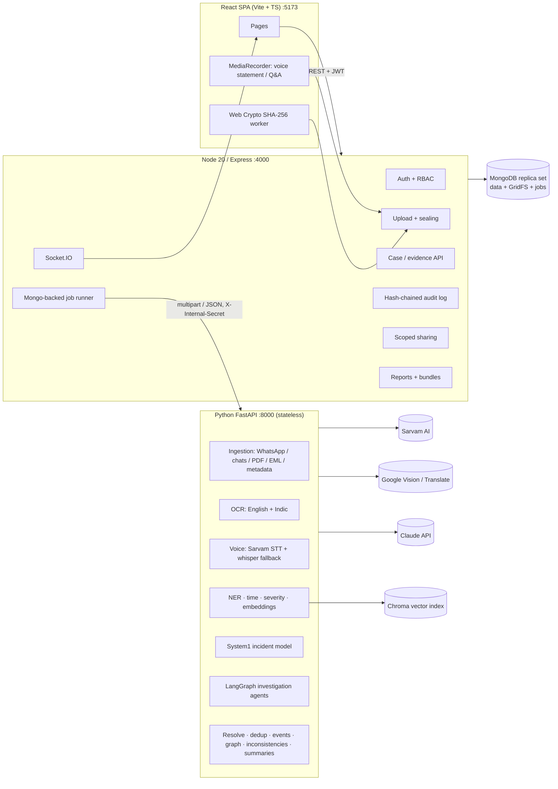

# TraceVault

**AI-powered digital evidence intelligence platform** · Build Beyond'26 · Problem Statement 3.2

TraceVault turns a victim's scattered digital evidence (WhatsApp exports, screenshots, voice notes, PDFs, emails, bank statements) into a **sealed, verifiable, cited case file** that a lawyer, police cyber cell or court can trust.

> Detailed specs: [spec.md](spec.md) (wins over [prd.md](prd.md) where they differ) · [ARCHITECTURE.md](ARCHITECTURE.md) · [future-advancement-spec.md](future-advancement-spec.md) · [services/ml/README.md](services/ml/README.md)

---

## Table of contents

1. [Problem statement](#1-problem-statement)
2. [Our solution](#2-our-solution)
3. [Core features](#3-core-features)
4. [Extra features](#4-extra-features)
5. [Tech stack](#5-tech-stack)
6. [Architecture](#6-architecture)
7. [Processing pipeline](#7-processing-pipeline)
8. [Roles and access control](#8-roles-and-access-control)
9. [Getting started](#9-getting-started)
10. [Testing and evaluation](#10-testing-and-evaluation)
11. [Repository layout](#11-repository-layout)
12. [Roadmap](#12-roadmap)
13. [Limitations and disclaimers](#13-limitations-and-disclaimers)

---

## 1. Problem statement

Victims of cyber harassment, sextortion, stalking and online financial fraud in India hold the evidence that could get them justice, but it is:

- **Scattered** across chat apps, screenshots, call recordings, emails, PDFs and bank statements.
- **Multilingual**: Hindi, Hinglish, Kannada and other Indian languages that standard tools do not read.
- **Fragile**: screenshots can be edited, timestamps disputed, and there is no chain of custody, so evidence is challenged or rejected.
- **Unstructured**: no timeline, no link between the "same person" across five accounts, no record of which amounts went where.
- **Hard to hand over**: police and lawyers receive a phone full of images instead of a report with hashes and a Section 63 BSA certificate.

The result: complaints are delayed, under-documented, or abandoned, and victims are re-traumatised by having to retell their story repeatedly.

**PS 3.2 asks for** a platform that ingests heterogeneous digital evidence, extracts and links the facts in it, reconstructs what happened, and produces output that is verifiable and usable by the justice system.

---

## 2. Our solution

TraceVault runs every piece of evidence through nine stages:

| # | Stage | What happens |
|---|---|---|
| 1 | **Preserve** | Every original is SHA-256 hashed in the browser *and* on the server, encrypted (AES-256-GCM), and written to an append-only, hash-chained audit log. |
| 2 | **Extract** | OCR, speech-to-text and NLP pull out text, people, phone numbers, UPI IDs, IFSC codes, amounts, dates and locations, in English and Indian languages. |
| 3 | **Link** | Entity resolution merges one real person across sources; duplicates are detected across formats. |
| 4 | **Reconstruct** | One chronological, clickable timeline across chats, images, calls and transactions. |
| 5 | **Flag** | Rule-based inconsistency detection (conflicting dates, mismatched amounts, edited screenshots), raised only when *independent* sources disagree. |
| 6 | **Summarize** | Every sentence in a summary cites its source chunk, and a validator checks the citations. |
| 7 | **Visualize** | An interactive relationship graph of people, accounts and money flows. |
| 8 | **Share and export** | Time-limited scoped access for lawyers and police; a report PDF with hashes, a draft Section 63 BSA certificate, and an offline-verifiable evidence bundle. |
| 9 | **Speak** | Victims can tell their story by voice in their own language, ask questions by voice, and hear summaries read aloud. |

The design rule throughout: **originals are never altered, every AI output is cited back to evidence, and the AI never has the final word.** It flags, drafts and suggests; humans decide.

---

## 3. Core features

### Evidence intake
- Drag-and-drop upload with streaming in-browser SHA-256 (hash-wasm in a Web Worker).
- MIME sniffing (`file-type`), optional ClamAV scan, encrypted storage in MongoDB GridFS.
- Supported sources: WhatsApp exports, Telegram / Instagram / Google Takeout chat exports, chat screenshots, images, PDFs, `.eml` emails, audio notes (`.opus/.ogg/.m4a/.mp3/.webm`), ZIP archives.
- Voice statement intake: record "what happened" in the browser (MediaRecorder).

### Extraction and intelligence
- **OCR**, two pipelines: on-device English (RapidOCR / PaddleOCR models on ONNX) and Indic (Google Vision, then Sarvam Vision), routed by privacy mode.
- **Speech-to-text**: Sarvam Saaras with segmentation and speaker diarization; local faster-whisper fallback.
- **Language**: script / Hinglish detection, English working copy via Sarvam Translate (or Google), PII redaction before any cloud call. Originals are always shown and cited.
- **NER**: rule-first extraction for UPI IDs, IFSC, phone numbers, money, plus optional spaCy; time normalisation; severity scoring.
- **Embeddings and RAG**: BGE-M3 embeddings in a case-scoped Chroma vector index.
- **System1 incident classifier** (Laya, open-source): multi-label classification into harassment, financial fraud, scams, UPI/bank fraud; advisory review of agent output.

### Case intelligence
- Entity resolution and cross-format deduplication (pHash/dHash, MinHash LSH, rapidfuzz).
- Event extraction and a unified timeline.
- Relationship graph with networkx analytics (centrality, communities), rendered in Cytoscape.js.
- Inconsistency flags with strict pre-flight gates ([inconsistency-flag-spec.md](inconsistency-flag-spec.md)).
- Cited summaries, case Q&A and narrative generation.

### Investigation agents (LangGraph)
Read-only agents over a scope-filtered case snapshot: **planner**, **evidence quality**, **cited retrieval (RAG)**, **financial investigation**, **knowledge graph and relationships**, **investigation replay / timeline**, **evidence gaps**, and **report drafting**.

### Integrity and chain of custody
- Hash-chained audit log written in MongoDB transactions.
- Merkle root over case evidence, Ed25519 signatures.
- OpenTimestamps anchoring.
- Report PDF with per-item hashes and a draft Section 63 BSA (Bharatiya Sakshya Adhiniyam) certificate.
- Exported ZIP bundle verifiable **offline** with [tools/verify_bundle/verify.py](tools/verify_bundle/verify.py); tampered bundles fail.

### Sharing and security
- Role-based access (Owner, Collaborator, Legal, Investigator, Admin), enforced in middleware *and* query filters.
- Time-limited, evidence-scoped share links.
- argon2 passwords, JWT, TOTP 2FA, helmet, rate limiting, CORS.
- Crypto-shred case deletion.
- Privacy modes that decide what may leave the machine (`local` / `auto` / cloud).

---

## 4. Extra features

Beyond the PS baseline, built during the hackathon:

| Feature | What it does |
|---|---|
| **Evidence authenticity check** (F1) | Error Level Analysis heatmap, editing-software and date-mismatch metadata checks, risk band, and a "needs attention" list in the viewer. |
| **Trusted timestamping** (F2) | RFC 3161 timestamp requests and verification, periodic anchoring of the audit chain, timestamps included in the bundle and checked by `verify.py`. |
| **Complaint helper** (F3) | 5-step wizard producing a cited complaint narrative with candidate offences (BNS / IT Act) and copy, print or `.txt` export. |
| **Regional legal layer** | Metro registry for Delhi, Mumbai, Kolkata, Chennai, Bengaluru, Hyderabad, Ahmedabad and Pune: which police unit, cyber cell, portal and helpline apply, plus recipient-specific PDF reports (police complaint, cyber-cell note, platform takedown, bank freeze request, lawyer brief). See [regional-states-india-spec.md](regional-states-india-spec.md). |
| **Safety mode and risk score** (F5) | Escalation gauge with named, cited signals; helplines; **Quick exit** (Esc Esc); Discreet mode for victims whose phone may be watched. |
| **Trauma-informed personalisation** | The case experience adapts tone, screen order, safety steps and support to the harm type. See [personalisation-spec.md](personalisation-spec.md). |
| **Multilingual UI** (F6) | Opt-in interface translation into Indian languages; evidence-derived text is protected from translation. |
| **Voice Q&A and read-aloud** | Ask questions about the case by voice; hear summaries in Indian languages (Sarvam Bulbul TTS). |
| **Investigation replay** | Step through how the case unfolded, with each step linked to source evidence. |
| **Evaluation harness** | Synthetic demo-case generator and scorer ([eval/run_eval.py](eval/run_eval.py)) reporting extraction and linking accuracy. |

---

## 5. Tech stack

| Layer | Technology |
|---|---|
| **Frontend** | React 18, Vite, TypeScript, React Router v6, TanStack Query, Cytoscape.js + fcose (graph), wavesurfer.js (audio + transcript sync), hash-wasm (in-browser SHA-256), i18next |
| **API** | Node 20, Express, Mongoose, Zod, Multer, Socket.IO (live progress), Pino logging |
| **Security** | argon2, jsonwebtoken, helmet, express-rate-limit, TOTP, Node `crypto` (SHA-256, AES-256-GCM, Ed25519), ClamAV (optional) |
| **Storage** | MongoDB 7 replica set: documents, GridFS encrypted blobs, audit chain, job queue |
| **Jobs** | MongoDB-backed job runner with retries, idempotency keys, debounce and crash recovery (no Redis) |
| **Exports** | archiver (ZIP bundles), PDF reports, OpenTimestamps, RFC 3161 TSP |
| **ML service** | Python 3.11, FastAPI, Uvicorn, Pydantic, httpx |
| **Ingestion** | PyMuPDF, Pillow, imagehash, Python `email`, langid |
| **OCR** | RapidOCR (PaddleOCR models on ONNX Runtime), Google Cloud Vision, Sarvam Vision |
| **Voice** | Sarvam AI (Saaras STT, Mayura translate, Bulbul TTS, text-LID), faster-whisper fallback |
| **NLP** | phonenumbers, dateparser, rapidfuzz, datasketch, networkx, optional spaCy |
| **Retrieval** | BAAI BGE-M3 embeddings, ChromaDB (case-scoped) |
| **Agents** | LangGraph |
| **Models** | Laya (System1 incident classifier, local or Hugging Face hosted), Claude API for summaries and Q&A, with offline fallbacks |
| **Deployment** | `concurrently` (dev), pm2 (demo box), Vercel serverless API option |
| **Testing** | Node test runner, Pytest, offline bundle verifier |

---

## 6. Architecture

Three processes, one database, no Docker.



**Why it is split this way**

- **Node/Express** owns users, permissions, integrity guarantees, storage, jobs and the public API.
- **Python FastAPI** is stateless: it receives bytes or a scope-filtered snapshot and returns JSON. It never touches the database, and it is the only component that talks to external AI providers. It binds to `127.0.0.1` and requires `X-Internal-Secret`.
- **MongoDB** holds everything (documents, audit chain, encrypted blobs, job queue): one thing to install and back up.

The agent-level view (intake → shared case knowledge → investigation agents → judge-facing evidence story) is in [tracevault-architecture.mermaid](tracevault-architecture.mermaid).

---

## 7. Processing pipeline

```
upload ─► hash + encrypt + audit ─► ingestion ─► OCR / STT ─► language (English working copy)
       ─► NLP (NER, time, severity, embeddings) ─► System1 classification
       ─► case rebuild (resolve, dedup, events, timeline, graph, inconsistencies)
       ─► agents (plan, quality, RAG, financial, graph, replay, gaps, report)
       ─► cited summary · report PDF · signed, timestamped bundle
```

Per-evidence jobs run concurrently with retries and exponential backoff; case-level rebuilds are debounced so 20 uploads trigger one rebuild. A failed step never blocks the rest of the case. Progress streams to the browser over Socket.IO.

---

## 8. Roles and access control

| Role | Who | Can do |
|---|---|---|
| **Owner** | Victim / complainant | Everything on their own cases, including sharing, export, privacy settings and crypto-shred deletion |
| **Collaborator** | Trusted friend or family | Upload, record statements, annotate, merge entities, edit events. Cannot share or export |
| **Legal** | Lawyer / NGO counsellor | Scoped read, annotate, explain inconsistencies, export report. Access expires |
| **Investigator** | Police cyber cell | Scoped read, verify integrity, export report and bundle. Access expires |
| **Admin** | Platform operator | Users, system health, job queue. **No case content** unless the Owner grants it |

---

## 9. Getting started

**Prerequisites:** Node 20, Python 3.11, MongoDB 7 as a replica set (or a free Atlas cluster), ffmpeg. Full setup including the replica-set step: [spec.md §13](spec.md).

```bash
npm install
```

```bash
cd services/ml && python -m venv .venv && .venv/Scripts/pip install -r requirements.txt && cd ../..
```

```bash
npm run keys:generate
```

```bash
cp .env.example .env
```

Then optionally add `SARVAM_API_KEY`, `ANTHROPIC_API_KEY`, `HF_TOKEN` and Google keys. All are optional: offline fallbacks exist.

```bash
npm run seed:demo
```

```bash
npm run dev
```

This starts web on `:5173`, API on `:4000` and ML on `:8000`.

Demo box: `npm run build -w apps/web && pm2 start ecosystem.config.cjs`.

---

## 10. Testing and evaluation

```bash
npm test
```

```bash
services/ml/.venv/Scripts/python -m pytest services/ml/tests
```

```bash
services/ml/.venv/Scripts/python eval/run_eval.py
```

```bash
python tools/verify_bundle/verify.py <unzipped bundle>
```

- `npm test` runs the API suite; integration tests skip without a MongoDB replica set.
- `run_eval.py` scores the demo case and writes `eval/report.{json,md}`.
- `verify.py` checks hashes, the Merkle root, signatures, the audit chain and timestamps on an exported bundle, fully offline.

---

## 11. Repository layout

| Path | What |
|---|---|
| [apps/web](apps/web) | React + Vite SPA |
| [apps/api](apps/api) | Express API: RBAC, sealing, audit chain, sharing, exports, regional legal engine, job runner |
| [services/ml](services/ml) | FastAPI: ingestion, OCR, voice, language, NLP, System1, agents, case intelligence |
| [data](data) | Legal catalogue (`data/legal/`) and demo data |
| [eval](eval) | Demo case generator and scorer |
| [tools/verify_bundle](tools/verify_bundle) | Offline verifier for exported evidence bundles |
| [scripts](scripts) | Key generation, seeding, ML launcher |
| [api](api) | Vercel serverless entry |
| [deck](deck), [demo-video](demo-video) | Presentation and demo assets |

---

## 12. Roadmap

From [future-advancement-spec.md](future-advancement-spec.md):

- **Wave 2:** mobile capture PWA with capture-time hashing, more importers.
- **Wave 3:** consent-based cross-case pattern linking, preservation and takedown letter generator, semantic case search, collaboration threads.
- **Wave 4:** live call capture with real-time transcription, IVR / phone-line intake.
- **Continuous:** production hardening (S3/R2 Object Lock, key management, monitoring).

---

## 13. Limitations and disclaimers

- **Not legal advice.** Offence mappings and regional legal data ship as `unverified` and are hidden from users until a lawyer reviews them.
- **Integrity is not authenticity.** Hashes and timestamps prove a file has not changed since capture, not that it was genuine before capture. Authenticity checks are signals, not proof.
- System1 scores are uncalibrated; labels stay advisory and flagged for owner review until calibration is validated.
- Cloud OCR, translation and STT send data to third parties only in the privacy modes that allow it; `local` mode keeps everything on the machine.
