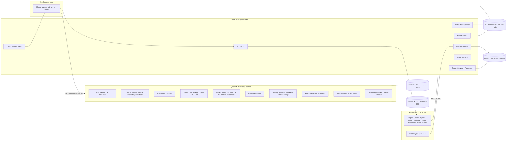
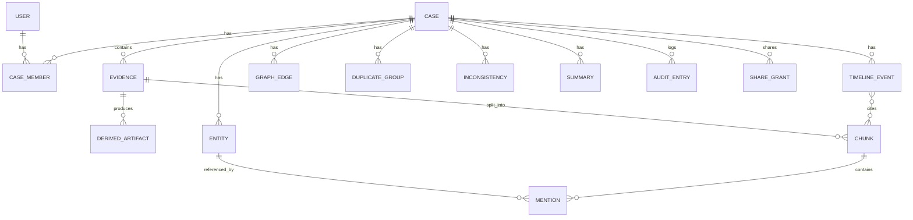
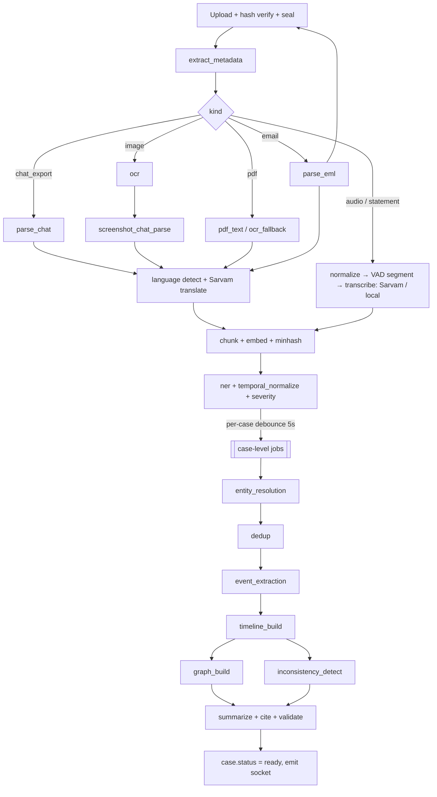

# PRD — TraceVault: AI-Powered Digital Evidence Intelligence Platform

> **Build Beyond'26 · PS 3.2** · Working name: *TraceVault* (placeholder)
> Stack: MERN (MongoDB, Express, React, Node) + Python ML microservice · Sarvam AI for voice · runs natively (no Docker)
> Document status: v1.1 · Owner: Team · Last updated: 2026-11-14
> Detailed feature spec: [spec.md](spec.md). Where the two disagree, spec.md wins.
>
> **v1.1 changes:** no Docker (all services run as native processes); Sarvam AI replaces faster-whisper as the primary speech engine and adds Indian-language translation, voice statement intake, voice Q&A and read-aloud summaries; a MongoDB-backed job runner replaces BullMQ/Redis; GridFS replaces MinIO.

---

## 1. Summary

Victims of harassment, fraud, stalking and sextortion collect evidence in many places: WhatsApp chats, screenshots, voice notes, emails, bank statements and PDFs. Building a coherent, court-ready story from that pile by hand takes days, and people often get it wrong.

**TraceVault** takes all of that evidence as uploads and processes it automatically. It:

1. **Preserves** every original file untouched, with a SHA-256 fingerprint and a tamper-evident audit trail.
2. **Extracts** text, people, phone numbers, dates, amounts and locations using OCR, speech-to-text (Sarvam AI) and NLP, in English, Hindi, Hinglish and other Indian languages.
3. **Links** the same person across sources and detects duplicate evidence, including a screenshot of a chat message that is also in the chat export.
4. **Reconstructs** one chronological incident timeline.
5. **Flags inconsistencies**, such as conflicting dates, edited screenshots, or metadata that doesn't match.
6. **Generates** structured incident summaries in which **every sentence cites its source evidence**.
7. **Visualizes** relationships between people, conversations and events as an interactive graph.
8. **Shares** cases securely with lawyers or police for a limited time, and exports a report with hashes and a draft Section 63 BSA certificate.
9. **Speaks** the victim's language: they can record their account by voice, ask questions by voice and hear summaries read aloud (Sarvam STT, translation and TTS).

---

## 2. Goals and non-goals

### 2.1 Goals (hackathon MVP)

| # | Goal | Measurable target |
|---|------|-------------------|
| G1 | Multi-format ingestion | WhatsApp `.txt`, images (`.png/.jpg`), audio (`.mp3/.ogg/.opus/.m4a/.wav`), PDF, `.eml` |
| G2 | Automatic extraction | Entities and dates extracted from all supported formats |
| G3 | Timeline reconstruction | Kendall's τ ≥ 0.85 against the ground-truth order on the demo case |
| G4 | Duplicate detection | Precision ≥ 0.9, recall ≥ 0.8 on the demo case, cross-modal included |
| G5 | Inconsistency detection | Catches all 3 planted inconsistencies in the demo case |
| G6 | Cited summaries | 100% of summary sentences carry a valid citation; unsupported sentences are flagged |
| G7 | Integrity | Any byte change to an original file or audit entry is caught by "Verify" |
| G8 | Speed | A 20-file case is fully processed in under 3 minutes on a laptop with a GPU, or under 6 minutes on CPU |
| G9 | Indian-language voice | Voice notes in Hindi, English, Hinglish and at least one regional language transcribed with WER ≤ 15% (Sarvam) |
| G10 | Native setup | A new laptop goes from clone to running app in ≤ 30 minutes without Docker |

### 2.2 Non-goals

- Forensic acquisition from devices (phone imaging, chat-database extraction). We only handle exported or uploaded files.
- Legal advice, or claims about whether evidence is admissible.
- Deepfake or manipulated-media detection (beyond basic metadata checks). Listed as future scope.
- Live monitoring of the user's accounts.
- Native mobile apps. The web app is responsive and works on phones.

---

## 3. Users and roles

| Role | Who | Permissions |
|------|-----|-------------|
| **Owner** | Victim / complainant | Full control of their cases: upload, annotate, merge entities, share, export, delete derived data (never originals once sealed) |
| **Collaborator** | Trusted friend or family member | Upload and annotate on cases they are invited to; cannot share or export |
| **Legal** | Lawyer or NGO counsellor | Read, annotate, export report. Access is scoped and has an expiry |
| **Investigator** | Police cyber cell | Read, verify integrity, export bundle. Access is scoped and has an expiry |
| **Admin** | Platform operator | User management and system health. **No access to case content** unless the Owner grants it |

RBAC is enforced at the API layer through middleware, and again at the query layer: every case query is filtered by `caseId ∈ user.accessibleCases`.

---

## 4. Core user flows

### 4.1 Create case → upload → insights
1. The Owner creates a case (title, incident type, optional description).
2. The Owner drags in files. **The browser computes a SHA-256 hash of each file before upload** using the Web Crypto API.
3. The server streams each file to storage, recomputes the hash, compares it with the client hash, seals the original and writes an `EVIDENCE_UPLOADED` audit entry.
4. The processing pipeline starts. Live progress is pushed to the UI over Socket.IO (e.g. "OCR 3/6 · Transcribing 1/2 · Linking entities…").
5. When processing finishes, the case dashboard shows the timeline, graph, inconsistencies, duplicates and summary.

### 4.2 Review and correct
- The Owner can merge or split entities ("Rahul K" = "+91 98xxxxxx12"), correct a wrong date, mark a duplicate as "not a duplicate", or dismiss an inconsistency.
- Every correction is an audit event. The timeline and summary are recomputed incrementally.

### 4.3 Share
- The Owner creates a share grant: recipient email, role (Legal or Investigator), scope (the whole case or selected evidence), expiry, and whether downloads are allowed.
- The recipient gets an invite link and signs in or registers. Their access is limited by scope and expiry, every view is logged, and documents are watermarked with the viewer's identity.

### 4.4 Export
- A **case report PDF** with the summary, timeline, inconsistencies, an evidence index with SHA-256 hashes, the audit-chain head hash, and a prefilled Section 63 BSA certificate draft.
- An **evidence bundle ZIP** with the originals, `manifest.json` (hashes, metadata) and `audit.jsonl`, which can be verified offline with the bundled `verify.py`.

---

## 5. Functional requirements

Priority: **P0** = required for the demo · **P1** = should have · **P2** = stretch goal

### 5.1 Auth and accounts
| ID | Requirement | P |
|----|-------------|---|
| A1 | Email + password registration and login (argon2id hashes) | P0 |
| A2 | JWT access token (15 min) plus a refresh token in an httpOnly, Secure, SameSite=Strict cookie | P0 |
| A3 | RBAC middleware (`requireCaseRole('owner','legal',…)`) | P0 |
| A4 | TOTP 2FA (otplib) | P2 |
| A5 | Rate limiting on auth routes (express-rate-limit) | P1 |

### 5.2 Case and evidence management
| ID | Requirement | P |
|----|-------------|---|
| C1 | CRUD for cases (title, type, status, tags) | P0 |
| C2 | Multi-file upload with client-side SHA-256 and a server-side check | P0 |
| C3 | Originals are immutable: no update endpoint; deletion only through a "redact request" that is audited and keeps the hash tombstone | P0 |
| C4 | Evidence viewer: the original side by side with the extracted text; entity highlights; audio player with a synced transcript | P0 |
| C5 | Tags, notes and annotations per evidence item (stored separately from the original) | P1 |
| C6 | Folder and source grouping (e.g. "WhatsApp – Rahul chat") | P1 |

### 5.3 Ingestion and extraction
| ID | Requirement | P |
|----|-------------|---|
| I1 | WhatsApp export parser (Android and iOS formats, multi-line messages, media placeholders) | P0 |
| I2 | Image OCR with per-word bounding boxes (English + Hindi) | P0 |
| I3 | Screenshot chat parser: turns OCR text into messages (sender, text, timestamp) using layout heuristics plus an LLM | P1 |
| I4 | Audio transcription via Sarvam (Saarika native-script transcript + Saaras English translation) with segment timestamps and language detection; local faster-whisper fallback | P0 |
| I5 | PDF text extraction, with OCR fallback for scanned pages | P0 |
| I6 | `.eml` parsing (headers, body, attachments, which are processed recursively) | P1 |
| I7 | Metadata extraction: EXIF (capture time, GPS, device, software), PDF metadata, file system times | P0 |
| I8 | Telegram JSON export parser | P2 |
| I9 | Speaker diarization for audio (Sarvam batch STT) | P1 |
| I10 | Language detection + Sarvam translation of non-English text chunks into an English working copy (originals always shown and cited) | P0 |

### 5.3a Voice (Sarvam)
| ID | Requirement | P |
|----|-------------|---|
| V1 | Voice statement intake: victim records their account in their own language → sealed as evidence, transcribed, drafted into a cited written statement, with case-field suggestions | P1 |
| V2 | Voice Q&A: ask a question by voice, get a cited answer in the same language (audio not retained) | P2 |
| V3 | Read-aloud summaries and answers in English and Indian languages (Bulbul TTS) | P2 |
| V4 | Privacy consent before any audio is sent to Sarvam; automatic local fallback on outage or quota cap | P0 |
| V5 | Demo voice notes generated with Sarvam TTS | P0 |

### 5.4 Intelligence
| ID | Requirement | P |
|----|-------------|---|
| N1 | Named-entity extraction: PERSON, PHONE, EMAIL, HANDLE, ORG, LOCATION, MONEY, UPI_ID, BANK_ACCT, URL, DATE/TIME | P0 |
| N2 | Temporal normalization: absolute and relative dates resolved against the document's reference time ("yesterday at 9" → ISO) | P0 |
| N3 | Entity resolution across sources (phone/email normalization, fuzzy names, co-occurrence), with human merge/split | P0 |
| N4 | Exact, near-duplicate and cross-modal duplicate detection | P0 |
| N5 | Event extraction: turns messages and passages into `TimelineEvent`s (actor, action, target, time, location, category) | P0 |
| N6 | Severity and harm classification for messages (threat, abuse, sexual harassment, extortion, financial request) | P1 |
| N7 | Inconsistency detection (rule-based + NLI) | P0 |
| N8 | Relationship-graph construction | P0 |
| N9 | Cited case summary (RAG) with citation validation | P0 |
| N10 | Natural-language Q&A over the case ("When did he first ask for money?") with citations | P1 |
| N11 | Pattern insights (escalation trend, message frequency heatmap, first contact, peak hours) | P1 |

### 5.5 Integrity, security and sharing
| ID | Requirement | P |
|----|-------------|---|
| S1 | SHA-256 of every original stored at upload, re-verifiable on demand | P0 |
| S2 | Hash-chained, append-only audit log for every action | P0 |
| S3 | "Verify integrity" for a case: rehashes files and checks the chain, with a red/green report | P0 |
| S4 | Per-case Merkle root over evidence hashes, included in exports | P1 |
| S5 | AES-256-GCM encryption at rest for originals (envelope encryption) | P1 |
| S6 | Ed25519-signed audit checkpoints (every N entries plus at export) | P1 |
| S7 | Share grants with scope, expiry, revocation and view logging | P0 |
| S8 | Viewer-identity watermark on the evidence viewer and exported PDFs | P1 |
| S9 | Public timestamp anchoring of the Merkle root (OpenTimestamps) | P2 |
| S10 | PII redaction before any cloud LLM call (optional setting) | P1 |

### 5.6 Reporting
| ID | Requirement | P |
|----|-------------|---|
| R1 | Case report PDF (Puppeteer render of a React print view) | P0 |
| R2 | Evidence bundle ZIP + `manifest.json` + `audit.jsonl` + offline `verify.py` | P1 |
| R3 | Prefilled Section 63 BSA certificate draft (Part A/B fields, hash values) | P1 |

---

## 6. System architecture



### 6.1 Why it is split this way
- **Node/Express** handles everything to do with users, money-style integrity guarantees and the API. This is where the team's MERN skills lie.
- **Python FastAPI** runs the local models (OCR, transformers) and is the only component that calls Sarvam and the LLM. It is stateless: it receives file bytes or text and returns JSON. It is easy to scale by itself on a GPU machine.
- **A MongoDB-backed job runner** (a `jobs` collection with atomic claims, retries, per-type concurrency and debounce) orchestrates the pipeline in Node. It runs inside the API process by default, so there is no Redis to install. Python workers stay simple HTTP handlers.
- **MongoDB** stores documents, entities, events, graph nodes/edges, embeddings, audit entries, jobs and (via GridFS) the encrypted original files. Cases are small (fewer than 10k chunks), so per-case brute-force vector search in Python is enough. Atlas Vector Search is an optional upgrade.
- **No Docker**: every service runs as a native process (`npm run dev` starts web, API and ML together with `concurrently`; `pm2` on a demo box). See spec.md §13 for setup.

---

## 7. Tech stack

| Layer | Choice | Notes |
|-------|--------|-------|
| Frontend | React 18 + Vite + TypeScript | |
| UI | Tailwind CSS + shadcn/ui + lucide-react | |
| State / data | TanStack Query, Zustand | |
| Routing | React Router v6 | |
| Timeline | vis-timeline | Zoom, grouping by source/person |
| Graph | Cytoscape.js + cytoscape-fcose | Or react-force-graph as a fallback |
| PDF / image viewer | react-pdf, custom canvas overlay for OCR boxes | |
| Audio | wavesurfer.js | Transcript sync |
| Uploads | react-dropzone + tus/multipart, Web Crypto `subtle.digest` | Hash computed in chunks for large files |
| Realtime | Socket.IO | |
| Backend | Node 20, Express, Zod validation | |
| ODM | Mongoose | |
| Queue | MongoDB-backed job runner (custom, `jobs` collection) | Replaces BullMQ + Redis |
| Storage | MongoDB GridFS (encrypted) | Optional prod upgrade: S3 / R2 with Object Lock |
| Auth | jsonwebtoken, argon2, helmet, cors, express-rate-limit | |
| Crypto | Node `crypto` (SHA-256, AES-256-GCM, Ed25519) | |
| Reports | Puppeteer, archiver (ZIP) | |
| ML service | Python 3.11, FastAPI, Uvicorn, Pydantic | |
| OCR | PaddleOCR (primary), Tesseract 5 `eng+hin` (fallback) | |
| STT | **Sarvam AI**: Saarika (speech-to-text), Saaras (speech → English); batch API for long audio + diarization | Hindi, English, Hinglish and other Indian languages. Offline fallback: faster-whisper `small` |
| Translation | Sarvam Translate (Mayura) | Non-English text chunks → English working copy |
| TTS | Sarvam Bulbul | Read-aloud summaries; demo voice-note generation |
| Audio processing | ffmpeg, silero-vad / webrtcvad | Normalize to 16 kHz WAV; segment ≤ 25 s for sync STT |
| NLP | spaCy `en_core_web_trf`, GLiNER (zero-shot custom entities), dateparser, phonenumbers, rapidfuzz | |
| Embeddings | `BAAI/bge-small-en-v1.5` or `intfloat/multilingual-e5-small` | Multilingual for Hinglish |
| NLI | `cross-encoder/nli-deberta-v3-base` | Contradiction + citation support |
| Severity | `unitary/toxic-bert` / detoxify + LLM labels | |
| Dedup | imagehash (pHash/dHash), datasketch (MinHash LSH) | |
| Metadata | Pillow / exifread, PyMuPDF, python `email` | |
| LLM | Claude API (`claude-haiku-5-5` for extraction, `claude-sonnet-5-5` for summaries); **local fallback**: Ollama (Llama/Qwen 7–8B) for privacy mode | |
| DevOps | Native processes, no Docker: `concurrently` for dev, `pm2` for the demo box; MongoDB local (single-node replica set) or Atlas | |
| Testing | Vitest + RTL, Jest + Supertest, Pytest | |

---

## 8. Data model (MongoDB)



### 8.1 Collections (key fields)

```js
// users
{ _id, email, passwordHash, name, platformRole: 'user'|'admin', totpSecret?, createdAt }

// cases
{ _id, ownerId, title, incidentType: ['harassment','fraud','stalking','sextortion','other'],
  status: 'draft'|'processing'|'ready'|'sealed', merkleRoot?, auditHead?, createdAt, updatedAt }

// caseMembers
{ caseId, userId, role: 'owner'|'collaborator'|'legal'|'investigator',
  grantId?, scope: { all: true } | { evidenceIds: [...] }, expiresAt?, revokedAt? }

// evidence  (originals: immutable after insert)
{ _id, caseId, uploaderId, originalName, mimeType, sizeBytes,
  sha256, clientSha256, storage: { backend:'gridfs'|'s3', fileId|key }, encryption: { alg:'AES-256-GCM', wrappedKey, iv },
  kind: 'chat_export'|'image'|'audio'|'pdf'|'email'|'statement'|'archive'|'other', parentEvidenceId?,
  sourceLabel, metadata: { exif?, pdf?, email?, fsTimes? },
  processing: { status, steps: { ocr:'done', stt:'skipped', ... }, error? },
  uploadedAt }

// derivedArtifacts   (OCR json, transcript json, parsed messages...)
{ _id, evidenceId, type: 'ocr'|'transcript'|'parsed_chat'|'pdf_text'|'email_parsed',
  storageKey | data, sourceSha256, generator: { name, version, model }, createdAt }

// chunks   (atomic citable units: one chat message, one OCR block, one transcript segment, one PDF paragraph)
{ _id, caseId, evidenceId, idx, text /* original */, textEn? /* Sarvam translation */, lang,
  sourceType: 'document'|'self_statement',
  locator: { page?, bbox?, startMs?, endMs?, lineNo?, messageIdx? },
  speaker?, timestamp?: ISODate, timestampSource: 'chat'|'exif'|'ocr'|'email_header'|'inferred',
  embedding: [Float], severity?: { label, score }, minhash?: [..] }

// entities
{ _id, caseId, type: 'PERSON'|'PHONE'|'EMAIL'|'HANDLE'|'ORG'|'LOCATION'|'UPI_ID'|'BANK_ACCT'|'URL',
  canonical: 'Rahul Kumar', aliases: ['Rahul','RK','+919812345612'],
  normalizedKeys: ['phone:+919812345612','email:rk@x.com'],
  resolution: { method: 'auto'|'manual', confidence }, mentionCount }

// mentions
{ entityId, chunkId, evidenceId, span: [start,end], surface, confidence }

// timelineEvents
{ _id, caseId, ts: ISODate, tsPrecision: 'second'|'minute'|'day'|'approx',
  title, description, category: 'threat'|'contact'|'payment'|'meeting'|'stalking'|'other',
  actors: [entityId], targets: [entityId], location?: entityId,
  citations: [{ chunkId, evidenceId }], confidence, severity, userEdited: Boolean }

// graphEdges   (nodes = entities + evidence + events; edges stored explicitly)
{ caseId, from: { kind, id }, to: { kind, id },
  type: 'MESSAGED'|'CALLED'|'PAID'|'THREATENED'|'MENTIONED_IN'|'APPEARS_WITH'|'SAME_AS_CANDIDATE',
  weight, firstTs, lastTs, citations: [chunkId] }

// duplicateGroups
{ caseId, kind: 'exact'|'near_image'|'near_text'|'cross_modal',
  members: [{ evidenceId, chunkId? }], score, canonicalMember, userVerdict?: 'confirmed'|'rejected' }

// inconsistencies
{ caseId, type: 'DATE_CONFLICT'|'METADATA_MISMATCH'|'CONTENT_CONTRADICTION'|'AMOUNT_MISMATCH'|'SENDER_MISMATCH'|'EDITED_FILE',
  severity: 'low'|'medium'|'high', description,
  sides: [{ chunkId, evidenceId, claim }], score, status: 'open'|'dismissed'|'explained', note? }

// summaries
{ caseId, kind: 'executive'|'chronological'|'per_person', sections: [
    { heading, sentences: [{ text, citations: [chunkId], supported: Boolean, nliScore }] } ],
  model, promptVersion, createdAt }

// auditEntries  (append-only; see §10.2)
{ caseId, seq, ts, actorId, actorRole, action, target: { kind, id },
  payloadHash, prevHash, hash, signature? }

// shareGrants
{ _id, caseId, createdBy, recipientEmail, role, scope, allowDownload,
  tokenHash, expiresAt, revokedAt?, acceptedBy?, views: Number }

// jobs, speakers, statements, providerUsage, and cases.settings (llmMode / voiceMode / translateMode)
// are defined in spec.md §8
```

**Indexes:** `evidence.caseId+sha256` (unique per case, for exact-duplicate detection on upload), `chunks.caseId+timestamp`, `entities.caseId+normalizedKeys`, `auditEntries.caseId+seq` (unique), `caseMembers.userId+caseId`.

---

## 9. Processing pipeline

### 9.1 Job DAG (per evidence item → case-level jobs)



- Per-evidence jobs run in parallel (concurrency: OCR 4, Sarvam STT 3, local STT 1, others 8).
- Case-level jobs are **debounced**: they run once after the last per-evidence job finishes, so 20 uploads trigger one rebuild instead of 20.
- Every step is **idempotent**, keyed by `(evidenceId, step, generatorVersion)`, so retries and reprocessing are safe.
- Every step writes progress to its job document and emits it to Socket.IO: `{caseId, evidenceId, step, status, pct, provider?}`.
- Each derived artifact records `sourceSha256` and the generator version, so results are reproducible and traceable.

### 9.2 Chunking rules
| Source | Chunk unit |
|--------|-----------|
| Chat export | 1 message (multi-line merged) |
| Screenshot | 1 detected chat bubble, or 1 OCR text block |
| Audio | 1 VAD-bounded speech segment (≤ 25 s), or 1 diarized speaker turn |
| PDF | 1 paragraph (≤ 800 chars), with page number |
| Email | Header block + body paragraphs |

Each chunk is the **atomic unit of citation**: `[E{evidenceIdx}:{chunkIdx}]` → resolves to an exact page/bbox/time offset.

---

## 10. ML / AI components in detail

### 10.1 Parsing
- **WhatsApp export.** Regex for both formats:
  - Android: `^(\d{1,2}/\d{1,2}/\d{2,4}), (\d{1,2}:\d{2})\s?([APap][Mm])? - ([^:]+): (.*)$`
  - iOS: `^\[(\d{1,2}/\d{1,2}/\d{2,4}), (\d{1,2}:\d{2}:\d{2})\s?([APap][Mm])?\] ([^:]+): (.*)$`
  - Lines that don't start with a timestamp are joined to the previous message. `<Media omitted>` and `image omitted` become media placeholders that can later be linked to uploaded images by timestamp proximity.
  - Day/month order is detected from the data (if any first field is > 12, the format is DD/MM).
- **Screenshot → chat messages.** PaddleOCR boxes are clustered into bubbles by vertical gap. Alignment gives the sender (right = device owner, left = other party). The header region is OCR'd for the contact name. In-bubble times are read with a regex. If confidence is low, the bubble text goes to the LLM with a strict JSON schema.
- **PDF.** PyMuPDF extracts text and metadata. If a page has fewer than 50 characters of text, it is rendered at 300 DPI and OCR'd.
- **Email.** The Python `email` library reads `From/To/Date/Message-ID/Received` headers. Attachments go back into the pipeline as child evidence (linked by `parentEvidenceId`).
- **Metadata.** EXIF `DateTimeOriginal`, `Software` (e.g. "Adobe Photoshop" is a red flag), GPS, `Make/Model`; PDF `CreationDate/ModDate/Producer`.

### 10.2 OCR
- PaddleOCR (`en` + `hi`/`devanagari`) is the primary engine, because it handles screenshots better. Tesseract 5 is the fallback.
- Preprocessing: grayscale, 2× upscale if width < 1000 px, adaptive threshold for dark-mode screenshots (detected by mean luminance, then inverted).
- Output: `{text, bbox, confidence}` per line. Blocks with confidence < 0.6 are flagged in the UI.

### 10.3 Speech-to-text (Sarvam AI)
- **Normalize** with ffmpeg to 16 kHz mono WAV; **segment** with VAD into ≤ 25 s pieces (Sarvam's synchronous STT takes short clips), keeping offsets into the original file.
- **Saarika** (`language_code=unknown`, auto-detect) gives the native-script transcript and language; **Saaras** gives the English transcript used by the NLP pipeline. Segments are transcribed in parallel.
- Audio longer than 120 s, or when speaker labels are wanted, goes to Sarvam's **batch STT job with diarization** (P1). Users can rename speakers and link them to entities.
- Output segments map to chunks with `startMs/endMs`, `text` (original) and `textEn`. Clicking a timeline event plays the exact audio offset.
- **Fallback**: faster-whisper `small` (`word_timestamps=True`, `vad_filter=True`) when the case is in `local` voice mode, when Sarvam fails after 3 retries, or when the daily usage cap is reached. The artifact records which provider was used.
- Model IDs are configurable (`SARVAM_STT_MODEL`, `SARVAM_STT_TRANSLATE_MODEL`, …); see spec.md §6 and §9.

### 10.3a Translation and other voice features
- Non-English text chunks get an English working copy (`textEn`) from Sarvam Translate; PII is replaced with placeholders first in redacted mode. Regex NER and citations use the original text; spaCy, NLI and the LLM use `textEn`.
- Voice statement intake, voice Q&A and read-aloud (Bulbul TTS) are specified in spec.md §6.4–6.6.

### 10.4 Entity extraction (NER)
A hybrid of three methods for reliability:
1. **Regex/validators** (high precision): phone numbers (`phonenumbers`, default region IN → E.164), emails, URLs, UPI IDs (`[\w.\-]+@[a-z]+`), bank account / IFSC patterns, ₹ amounts (`₹|Rs\.?|INR` + numbers, including "5k" and "2 lakh" normalization).
2. **spaCy `en_core_web_trf`**: PERSON, ORG, GPE/LOC, DATE, TIME, MONEY.
3. **GLiNER** (zero-shot) for custom labels such as `social_media_handle`, `vehicle_number` and `address`, and for Hinglish text where spaCy is weak.

Results are merged by span overlap; regex beats GLiNER, which beats spaCy. Each mention keeps a confidence score.

### 10.5 Temporal normalization
- Reference time = the chunk's own timestamp (chat message time, email Date header, EXIF capture time, or upload time as a last resort).
- `dateparser` with `RELATIVE_BASE=refTime`, `PREFER_DATES_FROM='past'`, `DATE_ORDER` taken from the detected locale.
- Each event gets a `tsPrecision`. Vague expressions ("last week") get `approx` and are drawn as a range bar on the timeline.
- Timezone defaults to the case timezone (Asia/Kolkata).

### 10.6 Entity resolution
Goal: one node per real-world person, even when they appear as "Rahul", "RK", "+91 98123 45612" and "rahul.k@gmail.com".

1. **Blocking**: group candidates by type and normalized key (E.164 phone, lowercased email, handle without `@`).
2. **Pairwise scoring** of name pairs with a weighted score:
   `s = 0.45·jaroWinkler(name) + 0.25·tokenSetRatio + 0.20·cooccurrence(shared chats/events) + 0.10·embeddingSim(context)`
3. **Hard links** (score = 1): a chat export header "Rahul K" whose messages contain "my number is 98123…"; a WhatsApp contact name shown next to a phone number in a screenshot header; email display name + address.
4. **Clustering**: union-find on pairs with `s ≥ 0.85`. Pairs with `0.65 ≤ s < 0.85` become `SAME_AS_CANDIDATE` suggestions shown in the UI for the user to confirm.
5. Manual merges and splits are stored as constraints (must-link / cannot-link) and respected on every re-run.

### 10.7 Duplicate detection (4 tiers)
| Tier | Method | Threshold |
|------|--------|-----------|
| Exact | SHA-256 equality (checked at upload) | equal |
| Near-image | pHash + dHash Hamming distance (handles re-compression, resizing, small crops) | pHash ≤ 8 and dHash ≤ 10 |
| Near-text | MinHash (128 perms, 5-shingles) + LSH → Jaccard check | ≥ 0.8 |
| **Cross-modal** | Screenshot bubble text vs chat-export messages: embedding cosine ≥ 0.9 **and** normalized edit similarity ≥ 0.85 **and** timestamp within ±2 min (if both known) | all three |

Cross-modal matches **confirm** that an event happened (two independent sources) and boost the event's confidence. A cross-modal match where the text differs somewhat (cosine ≥ 0.9 but edit similarity < 0.85) raises a `CONTENT_CONTRADICTION` inconsistency, a possible sign of an edited screenshot.

Duplicates are **grouped, never deleted**: the canonical member is shown and the rest are collapsed under it.

### 10.8 Event extraction and severity
- Each chunk (or a small window of consecutive chat messages) goes to the LLM (`claude-haiku-5-5`) with a strict JSON schema:
  ```json
  { "events": [{ "title": "...", "category": "threat|contact|payment|meeting|stalking|other",
                 "actor": "<mention surface>", "target": "...", "time_expression": "...",
                 "location": "...", "amount": "...", "evidence_chunk_ids": ["c_12","c_13"] }] }
  ```
  The prompt forbids inventing facts: every event must list the source chunk IDs it came from, and the validator rejects any ID not in the input.
- Actor and target surfaces are mapped to resolved entity IDs through mentions.
- **Severity**: toxic-bert score + LLM label (`threat`, `sexual`, `extortion`, `abuse`, `financial_request`, `benign`) → severity 0–3. Drives the timeline colour and "key moments".
- Fallback with no LLM (offline/privacy mode): every chat message or transcript segment with severity ≥ 1 or a MONEY/LOCATION entity becomes an event titled with its first 80 characters.

### 10.9 Timeline reconstruction
1. Collect events and assign timestamps by source priority: `chat/email header (exact)` > `EXIF` > `OCR'd in-image time` > `normalized expression` > `inferred`.
2. **Infer missing times**: an event with no timestamp inherits bounds from its neighbours in the same source (message order within a chat or transcript is reliable). Shown as approximate.
3. **Merge** events across sources when they share actors, are within ±10 min and have embedding similarity ≥ 0.85. Citations are combined, which increases confidence ("corroborated by 3 sources").
4. Sort; the UI groups lanes by **source** or by **person**.
5. **Evaluation**: Kendall's τ and the share of events with the correct timestamp, compared with the ground-truth order (§13).

### 10.10 Inconsistency detection
**Rule-based checks** (deterministic and explainable):
| Rule | Example |
|------|---------|
| `METADATA_MISMATCH` | Time shown in a screenshot ≠ EXIF `DateTimeOriginal` by more than 24 h |
| `EDITED_FILE` | EXIF `Software` contains an editor (Photoshop, Snapseed, PicsArt, Canva), or PDF `ModDate` ≫ `CreationDate` |
| `DATE_CONFLICT` | The same merged event has source timestamps more than 24 h apart |
| `AMOUNT_MISMATCH` | The same payment event has different ₹ amounts across sources (e.g. chat "sent 5000" vs bank statement 50,000) |
| `SENDER_MISMATCH` | A cross-modal duplicate bubble is attributed to different senders |
| `IMPOSSIBLE_SEQUENCE` | A reply exists before the message it quotes |

**Model-based check (NLI)**:
- Candidate pairs: chunks from **different evidence items** that share at least one entity and are within a time window (or both untimed). Capped at the top 200 pairs by embedding similarity.
- `nli-deberta-v3-base` scores (premise, hypothesis) in both directions; `contradiction ≥ 0.85` creates a `CONTENT_CONTRADICTION`.
- The LLM writes a one-line explanation of the contradiction, constrained to the two quoted texts.

Every inconsistency shows **both sides with links**; the user can dismiss it or explain it ("I sent it again later").

### 10.11 Relationship graph
- **Nodes**: Person/Account entities (sized by mention count), Evidence (icon by kind), Events (optional layer), Locations, Money/UPI.
- **Edges**: `MESSAGED` (from chat sender/receiver, weighted by count, with first/last timestamps), `PAID` (from payment events), `THREATENED` (events with category threat), `MENTIONED_IN`, `APPEARS_WITH` (co-occurrence in a chunk), `SAME_AS_CANDIDATE` (dashed).
- **Analytics** (networkx in the ML service): degree and betweenness centrality to show "central figures"; Louvain communities to show groups of accounts (useful in fraud rings with several mule UPI IDs).
- **UI**: a time slider filters edges by `firstTs..lastTs`; clicking an edge opens the cited messages.

### 10.12 Cited summaries (RAG with verification)
1. **Retrieve**: for each summary section (Overview, Parties involved, Chronology, Threats & harm, Financial loss, Inconsistencies & gaps), gather the top-k chunks: timeline events + highest-severity chunks + per-person top chunks.
2. **Generate** (`claude-sonnet-5-5`): the context contains chunks labelled `[c_123]`. Instructions: *write only factual statements present in the context; end every sentence with one or more citations; do not speculate about intent; use neutral language*. Output as JSON `{sections:[{heading, sentences:[{text, citations}]}]}`.
3. **Validate**:
   - Every citation ID must exist in the case and in the provided context; otherwise the sentence is marked invalid.
   - **Support check**: NLI(premise = concatenated cited chunks, hypothesis = sentence) must give entailment ≥ 0.7; otherwise `supported=false`. The sentence is shown with a ⚠ "not fully supported by cited evidence" badge, or regenerated once.
4. **UI**: hovering a citation shows a source preview card (thumbnail with a highlighted bbox, an audio snippet, or the chat message). Clicking opens the evidence viewer at that position.
5. **Q&A (P1)**: same pipeline with the question as the retrieval query.

### 10.13 Privacy mode for LLM use
- **Setting per case**: `cloud` (Claude API), `cloud_redacted` (PII is replaced with placeholders such as `PERSON_1` and `PHONE_2` before sending, and restored on return), or `local` (Ollama model; slower, lower quality, but no data leaves the server).
- **Voice mode per case**: `sarvam` or `local`. Audio can't be redacted before transcription, so `sarvam` requires explicit Owner consent; without it, the case uses local faster-whisper. `local` LLM mode also switches voice and translation to local/off by default.
- Calls are not logged in prompts in our database; only `promptVersion`, model and a hash of the input are stored.

---

## 11. Integrity and security design

### 11.1 Evidence sealing
1. The browser computes `clientSha256` (chunked `crypto.subtle.digest` via a streaming hash library such as hash-wasm for large files).
2. The server streams the upload through a hashing transform → `serverSha256`; the upload is rejected if the two hashes differ.
3. The original is encrypted (AES-256-GCM, random 256-bit data key per file; the data key is wrapped with a master KEK from env/KMS) and stored in GridFS with filename `cases/{caseId}/originals/{sha256}`.
4. GridFS has no Object Lock, so immutability comes from the API exposing no update or delete path for originals, only the upload service writing to the bucket, and hash + Merkle + audit-chain verification. In production, an S3/R2 bucket with **Object Lock (compliance mode)** can be swapped in.
5. Audit entry: `EVIDENCE_UPLOADED {evidenceId, sha256, size, mime}`.
6. Derived artifacts are stored separately and are never mistaken for originals. Each references `sourceSha256`.

### 11.2 Tamper-evident audit chain
```
entry_n = { caseId, seq:n, ts, actorId, actorRole, action, target, payloadHash }
hash_n  = SHA256( hash_{n-1} || canonicalJSON(entry_n) )        // hash_0 = SHA256("TRACEVAULT_GENESIS:" + caseId)
```
- Canonical JSON: sorted keys, no whitespace, ISO timestamps (RFC 8785-style).
- Writes are serialized per case with a MongoDB transaction plus a unique `(caseId, seq)` index, so there are no gaps or forks.
- Every 50 entries and at every export, a **checkpoint** `{seq, hash}` is signed with the server's **Ed25519** key. The public key is published in the app and embedded in exports.
- **Audited actions**: login, case create, upload, view evidence, download, annotate, entity merge/split, event edit, dismiss inconsistency, regenerate summary, share create/accept/revoke, export, verify.
- **Verify** endpoint: recomputes the chain from genesis, checks signatures, rehashes every original from storage and compares it with the recorded `sha256`. Reports the first broken link, if any.
- **Demo moment**: in MongoDB Compass, change one byte in an audit entry or overwrite a GridFS chunk, then click Verify. The result turns red and points to the exact entry or file.

### 11.3 Merkle root (P1)
- Leaves are the evidence `sha256` values sorted by upload sequence; the root is a binary SHA-256 Merkle tree.
- The root is stored on the case, included in the report header, and can optionally be anchored with OpenTimestamps (P2) to prove the evidence set existed at time T.
- A Merkle proof lets a single file be verified against the report without sharing the whole case.

### 11.4 Application security
| Area | Control |
|------|---------|
| Transport | HTTPS only, HSTS |
| Headers | helmet (CSP, frame-ancestors none) |
| Auth | argon2id; short-lived JWT; refresh rotation with reuse detection |
| Authorization | Case-scoped RBAC middleware plus query-level filtering; share-grant scope and expiry checked on every request |
| Input | Zod schemas; file type sniffed from magic bytes (`file-type`), not only from the extension; size limit 200 MB per file |
| Uploads | Stored outside the web root; served only through signed, short-TTL URLs after an auth check; `Content-Disposition: attachment` for non-previewable types |
| Malware | ClamAV scan on upload (P2) |
| Secrets | `.env` only, never committed; KEK and Ed25519 key loaded from env/KMS |
| Rate limits | Auth, upload and LLM-backed endpoints |
| Logging | No evidence content in application logs |
| Data retention | Owner can delete a case: derived data is purged, originals are crypto-shredded (wrapped key destroyed) and a tombstone audit entry keeps the hash |

### 11.5 Sharing
- Share token = 32 random bytes; only its SHA-256 is stored. Link: `/share/accept?t=…`.
- The recipient must authenticate. The grant binds to their user ID on accept, so a forwarded link is useless to anyone else.
- Scoped views hide out-of-scope evidence everywhere, including the timeline, graph and summary citations (out-of-scope citations are shown as "restricted").
- Watermark overlay on the viewer and exported PDFs: `Viewed by {email} · {timestamp} · Case {id}`.

---

## 12. API specification

Base: `/api/v1` · Auth: `Authorization: Bearer <jwt>` · Errors: `{ error: { code, message } }`

### 12.1 Node API (public)
| Method | Path | Description | Roles |
|--------|------|-------------|-------|
| POST | `/auth/register` | Create account | public |
| POST | `/auth/login` | Login → access token + refresh cookie | public |
| POST | `/auth/refresh` | Rotate tokens | cookie |
| POST | `/auth/logout` | Revoke refresh token | any |
| GET | `/cases` | List accessible cases | any |
| POST | `/cases` | Create case | user |
| GET | `/cases/:id` | Case overview + stats + processing status | member |
| PATCH | `/cases/:id` | Update title/type/tags | owner |
| DELETE | `/cases/:id` | Crypto-shred delete | owner |
| POST | `/cases/:id/evidence` | Multipart upload (`file`, `clientSha256`, `sourceLabel`) | owner, collaborator |
| GET | `/cases/:id/evidence` | List evidence | member (scoped) |
| GET | `/evidence/:eid` | Evidence detail + metadata + derived artifacts | member (scoped) |
| GET | `/evidence/:eid/original` | Signed URL to the decrypted original stream (audited) | member (scoped) |
| GET | `/evidence/:eid/chunks` | Extracted chunks with locators | member (scoped) |
| POST | `/evidence/:eid/reprocess` | Re-run the pipeline | owner |
| GET | `/cases/:id/timeline` | Events (`?from&to&person&category&minSeverity`) | member |
| PATCH | `/events/:evtId` | Edit time/title/category (audited, `userEdited=true`) | owner, collaborator |
| GET | `/cases/:id/entities` | Entities + aliases + suggestions | member |
| POST | `/cases/:id/entities/merge` | `{entityIds:[...]}` | owner, collaborator |
| POST | `/entities/:entId/split` | `{aliasesToSplit:[...]}` | owner, collaborator |
| GET | `/cases/:id/graph` | `{nodes, edges}` (`?from&to&layers`) | member |
| GET | `/cases/:id/duplicates` | Duplicate groups | member |
| PATCH | `/duplicates/:gid` | `{verdict}` | owner, collaborator |
| GET | `/cases/:id/inconsistencies` | List | member |
| PATCH | `/inconsistencies/:iid` | `{status, note}` | owner, collaborator, legal |
| GET | `/cases/:id/summary` | Latest summary | member |
| POST | `/cases/:id/summary/regenerate` | Regenerate | owner |
| POST | `/cases/:id/ask` | `{question}` → cited answer | member |
| GET | `/cases/:id/audit` | Paginated audit entries | owner, legal, investigator |
| POST | `/cases/:id/verify` | Full integrity verification report | member |
| POST | `/cases/:id/shares` | Create grant | owner |
| GET | `/cases/:id/shares` | List grants | owner |
| DELETE | `/shares/:sid` | Revoke | owner |
| POST | `/shares/accept` | `{token}` | authenticated |
| POST | `/cases/:id/export/report` | Generate PDF → signed URL | owner, legal, investigator |
| POST | `/cases/:id/export/bundle` | Generate ZIP → signed URL | owner, investigator |

**Socket.IO** namespace `/cases`, room `case:{id}`, events: `processing.progress`, `processing.done`, `processing.error`, `summary.ready`.

### 12.2 ML service API (internal only, network-isolated, shared-secret header)
| Method | Path | Input | Output |
|--------|------|-------|--------|
| POST | `/metadata` | `{fileUrl, mime}` | `{exif, pdf, email, warnings[]}` |
| POST | `/parse/whatsapp` | `{fileUrl}` | `{messages:[{ts, sender, text, media?}]}` |
| POST | `/ocr` | `{fileUrl, langs}` | `{lines:[{text,bbox,conf}], darkMode}` |
| POST | `/parse/screenshot-chat` | `{ocr}` | `{header, messages:[{sender, side, text, time, bbox}]}` |
| POST | `/transcribe` | `{fileUrl}` | `{lang, segments:[{start,end,text,words[]}]}` |
| POST | `/parse/pdf` | `{fileUrl}` | `{pages:[{n, text, ocrUsed}], meta}` |
| POST | `/parse/eml` | `{fileUrl}` | `{headers, body, attachments[]}` |
| POST | `/nlp/enrich` | `{chunks:[{id,text,refTime}]}` | `{mentions[], times[], severity[], embeddings[], minhash[]}` |
| POST | `/case/resolve-entities` | `{caseId, mentions, constraints}` | `{entities[], suggestions[]}` |
| POST | `/case/dedup` | `{caseId, items}` | `{groups[]}` |
| POST | `/case/events` | `{chunks, entities}` | `{events[]}` |
| POST | `/case/timeline` | `{events, chunks}` | `{events[] (ordered, merged)}` |
| POST | `/case/graph` | `{entities, events, chunks}` | `{nodes[], edges[], metrics}` |
| POST | `/case/inconsistencies` | `{events, chunks, evidenceMeta}` | `{items[]}` |
| POST | `/case/summarize` | `{caseCtx, mode}` | `{sections[]}` (validated) |
| POST | `/case/ask` | `{question, caseCtx}` | `{answer, sentences[]}` |
| GET | `/health` | — | model load status, GPU availability |

The ML service fetches files through **short-TTL presigned URLs** issued by Node and never has DB credentials. Results return to Node, which persists them.

---

## 13. Evaluation plan (show these numbers to judges)

### 13.1 Demo / eval dataset — "Case: Priya vs. unknown harasser + UPI fraud" (synthetic)
Built with a script plus an LLM, with **ground truth JSON** checked in:
- 1 WhatsApp export (~300 messages over 6 weeks, Hinglish, escalating threats, money requests)
- 8 screenshots: 5 genuine chat screenshots (rendered from the export with an HTML chat template, then screenshotted), 1 resized re-share (near-duplicate), 1 with the **date edited** and `Software=Snapseed` EXIF (planted inconsistency), 1 Instagram DM screenshot from a second handle of the same person (entity-resolution test)
- 2 voice notes (TTS, Hindi + English) containing a threat and a location
- 1 bank statement PDF with UPI debits, one amount **different from what the chat claims** (planted inconsistency)
- 1 email from the harasser's alternate address mentioning the same phone number (entity-resolution link)
- 1 police complaint draft PDF with a **wrong date** for the first incident (planted inconsistency)

Ground truth: event list with timestamps, entity clusters, duplicate pairs, inconsistencies.

### 13.2 Metrics
| Component | Metric | Target |
|-----------|--------|--------|
| OCR | Character error rate (CER) on screenshots | ≤ 5% |
| STT | Word error rate (WER) | ≤ 15% (Hinglish) |
| NER | Entity-level F1 (PHONE/EMAIL/UPI/MONEY/PERSON) | ≥ 0.85 |
| Entity resolution | Pairwise F1 / B³ | ≥ 0.85 |
| Dedup | Precision / recall per tier | ≥ 0.9 / ≥ 0.8 |
| Timeline | Kendall's τ; % events within ±5 min of truth | ≥ 0.85; ≥ 80% |
| Inconsistency | Recall on planted items; false positives per case | 3/3; ≤ 3 |
| Summary | Citation validity; NLI-supported sentence rate; hallucination rate (manual check) | 100%; ≥ 90%; 0 unsupported facts shown without warning |
| Integrity | Tamper detection rate over 50 random mutations | 100% |
| Latency | End-to-end processing for the demo case | < 3 min (GPU) |

Comparison with a baseline: **manual reconstruction time** (one teammate timed doing it by hand) vs TraceVault time. Show this on the pitch slide.

`eval/run_eval.py` produces a markdown/JSON report; a CI job runs it on every merge to `main`.

---

## 14. Frontend specification

### 14.1 Pages
| Route | Page | Key components |
|-------|------|----------------|
| `/login`, `/register` | Auth | Form + Zod |
| `/cases` | Case list | Cards with status, evidence count, last activity |
| `/cases/:id` | **Overview** | Stats (evidence, people, events, inconsistencies), processing progress, key moments, mini timeline, top entities |
| `/cases/:id/upload` | Upload | Dropzone, per-file client hash display, progress, duplicate warning on hash collision |
| `/cases/:id/evidence` | Evidence library | Table/grid, filters by kind/source/person, duplicate grouping |
| `/cases/:id/evidence/:eid` | **Viewer** | Original (image with OCR boxes / PDF / audio waveform / chat-styled view) ‖ extracted text with entity highlights, metadata panel, hash + "verify file" button |
| `/cases/:id/timeline` | **Timeline** | vis-timeline lanes (by source/person), severity colours, approx-range bars, filters, event drawer with citations, edit event |
| `/cases/:id/graph` | **Graph** | Cytoscape fcose layout, node-type toggles, time slider, centrality sizing, community colours, merge suggestion handling |
| `/cases/:id/inconsistencies` | Inconsistencies | Side-by-side cards with both sources, severity, dismiss/explain |
| `/cases/:id/summary` | **Summary** | Sections, citation chips with hover preview, ⚠ badges, regenerate, Q&A box |
| `/cases/:id/audit` | **Audit & integrity** | Chain table (seq, actor, action, hash prefix), Verify button with green/red result report, Merkle root, signed checkpoints |
| `/cases/:id/share` | Sharing | Create grant form, active grants, view counts, revoke |
| `/cases/:id/export` | Export | Report PDF / bundle ZIP / certificate draft |
| `/share/accept` | Accept invite | |

### 14.2 UX principles
- **Trauma-informed**: calm palette; content warnings before high-severity text; option to blur images and mask abusive words by default; no gamified language.
- **Every insight is traceable**: anything the AI produces has a "view source" affordance.
- **AI output is labelled as AI**, with confidence shown, and is always editable by the user.
- Responsive down to 360 px; keyboard accessible; WCAG AA contrast.

---

## 15. Non-functional requirements

| Category | Requirement |
|----------|-------------|
| Performance | API p95 < 300 ms for non-ML endpoints; timeline/graph payload < 1 MB for 2k events (server-side filtering) |
| Throughput | Pipeline handles 50 files/case and 5 concurrent cases on one GPU box |
| Scalability | Stateless API and ML containers; horizontal scale via Redis queue; storage on S3 |
| Reliability | Job retries with exponential backoff (3 attempts); partial results visible; a failed step never blocks other evidence |
| Reproducibility | Generator versions recorded; deterministic seeds; prompt versions stored |
| Privacy | Data minimization; local-LLM mode; no third-party analytics on case pages; DPDP Act 2023-aligned consent and deletion |
| Observability | pino logs (no content), BullMQ dashboard (bull-board), `/health` endpoints, per-step timing metrics |
| Portability | `docker compose up` brings up the full stack; seed script loads the demo case |

---

## 16. Repository structure

```
tracevault/
├── apps/
│   ├── web/                     # React + Vite + TS
│   │   ├── src/
│   │   │   ├── pages/           # Cases, Overview, Upload, Viewer, Timeline, Graph, Summary, Audit, Share, Export
│   │   │   ├── components/      # CitationChip, EvidencePreview, HashBadge, SeverityTag, EntityHighlighter...
│   │   │   ├── features/        # timeline/, graph/, upload/ (hashing worker), viewer/
│   │   │   ├── lib/             # api client, socket, crypto (web worker sha256)
│   │   │   └── store/
│   │   └── vite.config.ts
│   └── api/                     # Node + Express
│       ├── src/
│       │   ├── routes/          # auth, cases, evidence, timeline, entities, graph, shares, export, audit
│       │   ├── middleware/      # auth, rbac, scope, rateLimit, validate
│       │   ├── models/          # Mongoose schemas (§8)
│       │   ├── services/        # storage, crypto (envelope, ed25519), audit-chain, merkle, report, share
│       │   ├── queue/           # BullMQ queues, flows, workers, ml-client
│       │   ├── sockets/
│       │   └── templates/       # report + BSA certificate HTML
│       └── test/
├── services/
│   └── ml/                      # Python FastAPI
│       ├── app/
│       │   ├── main.py
│       │   ├── routers/         # parse, ocr, stt, nlp, case
│       │   ├── parsers/         # whatsapp.py, screenshot_chat.py, pdf.py, eml.py, metadata.py
│       │   ├── nlp/             # ner.py, temporal.py, severity.py, embed.py
│       │   ├── case/            # resolve.py, dedup.py, events.py, timeline.py, graph.py, inconsistency.py, summarize.py
│       │   ├── llm/             # client.py (claude/ollama), prompts/, redact.py, schemas.py
│       │   └── models_cache/
│       ├── tests/
│       └── requirements.txt
├── eval/
│   ├── data/priya_case/         # synthetic evidence + ground_truth.json
│   ├── generate_case.py
│   └── run_eval.py
├── tools/verify_bundle/verify.py   # offline bundle verifier
├── docker-compose.yml
├── .env.example
└── README.md
```

---

## 17. Hackathon build plan (assumes a 4-person team, ~30 hours)

| Member | Track |
|--------|-------|
| **FE** | React app: upload, viewer, timeline, graph, summary, audit pages |
| **BE** | Express API, auth/RBAC, storage + sealing, audit chain, queue orchestration, sockets, report export |
| **ML-1** | Parsers, OCR, STT, metadata, chunking, embeddings, dedup |
| **ML-2** | NER, temporal, entity resolution, events, timeline, inconsistencies, summary + citation validation |

| Hours | Milestone | Done when |
|-------|-----------|-----------|
| 0–2 | Setup | Repo, docker-compose (mongo/redis/minio), schemas agreed, **demo dataset script started** (ML-2), API contract frozen |
| 2–8 | Skeletons | Auth + case CRUD + upload with hashing + audit chain (BE); routing, layout, upload page (FE); WhatsApp parser + OCR + STT endpoints (ML-1); NER + temporal on sample text (ML-2) |
| 8–14 | Pipeline end to end | BullMQ flow calls all ML endpoints and persists chunks and entities; viewer shows extracted text with highlights; **first full run on the demo case** |
| 14–20 | Intelligence | Entity resolution, dedup (incl. cross-modal), events, timeline, graph; FE timeline + graph pages live |
| 20–25 | Wow features | Inconsistency detection, cited summary + validator, Verify-integrity page with the tamper demo |
| 25–28 | Share + export | Share grant flow, report PDF with hashes and certificate draft; eval script numbers |
| 28–30 | Polish + pitch | Bug bash, seed demo data, rehearse a 3-minute demo, record a backup video |

**Cut line** (drop in this order if behind): Q&A → diarization → Merkle/OTS → bundle ZIP → email parsing → screenshot bubble parsing (fall back to plain OCR blocks).

### 17.1 Demo script (3 minutes)
1. **Problem** (20 s): "Priya has 13 files across 5 formats. Police ask her for a timeline."
2. **Upload** (20 s): drag all files in; hashes appear instantly; live progress.
3. **Timeline** (40 s): 6 weeks of escalation, colour-coded; click a threat → plays the exact second of the voice note.
4. **Graph** (30 s): "Rahul", an Instagram handle and a second email are auto-linked into one person; 2 UPI IDs form a mule cluster.
5. **Inconsistencies** (30 s): edited screenshot caught (EXIF Snapseed + date mismatch); chat claims ₹5,000 but bank shows ₹50,000.
6. **Summary** (20 s): every sentence cited; hover shows the source.
7. **Integrity** (20 s): tamper with one DB byte → Verify turns red at entry #47. Export the report with hashes and the certificate draft.

---

## 18. Risks and mitigations

| Risk | Impact | Mitigation |
|------|--------|-----------|
| LLM hallucination in summaries/events | Destroys trust (legal context) | Chunk-ID-grounded prompts, ID validation, NLI support check, ⚠ badges, human edit |
| Hinglish / Devanagari OCR and NER quality | Missed entities | PaddleOCR + Tesseract `hin`; GLiNER multilingual; regex for high-value entities (phones, UPI, ₹) |
| Whisper is slow on CPU | Demo latency | `small` model + VAD; pre-process the demo case; GPU (Colab/Kaggle tunnel) if available |
| Scope creep | Unfinished demo | P0/P1/P2 discipline; cut line (§17) |
| Sending sensitive data to a cloud LLM | Privacy objection from judges | Redacted and local modes; explain clearly in the pitch |
| Screenshot chat parsing varies by app/theme | Wrong senders | Fall back to block-level chunks; dark-mode inversion; target WhatsApp light/dark only for the MVP |
| Dataset realism | Weak eval credibility | Generated from a realistic script; ground truth hand-checked; state clearly that it is synthetic |
| Legal overclaiming | Credibility | Frame the certificate as a "draft to assist"; no admissibility claims |

---

## 19. Future scope
- Deepfake/manipulation detection (error level analysis, C2PA content credentials check, audio spoof detection).
- Direct integrations: National Cybercrime Reporting Portal (cybercrime.gov.in) complaint pre-fill, Google Takeout/Instagram data download import.
- Mobile capture app that hashes at capture time (stronger chain of custody).
- Multi-victim pattern linking for NGOs and police (same offender across cases, with consent).
- Regional language UI and voice-guided intake.

---

## 20. Glossary
- **Chunk**: the smallest citable piece of extracted content (one message, OCR block, transcript segment or paragraph).
- **Cross-modal duplicate**: the same content captured in two formats (e.g. a chat-export message and a screenshot of it).
- **NLI**: natural language inference; a model that decides whether text A entails, contradicts or is neutral to text B.
- **Hash chain**: each log entry includes the hash of the previous one, so editing any entry breaks every hash after it.
- **Merkle root**: one hash summarizing a set of file hashes; any file can be proven to be part of the set.
- **BSA §63**: Section 63 of the Bharatiya Sakshya Adhiniyam, 2023, which covers certificates for electronic records (verify the current text before relying on it).
