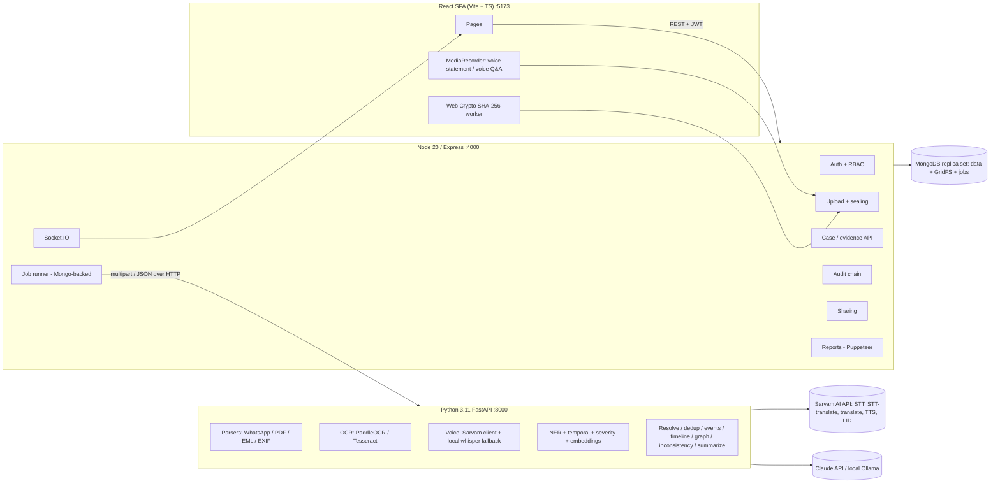
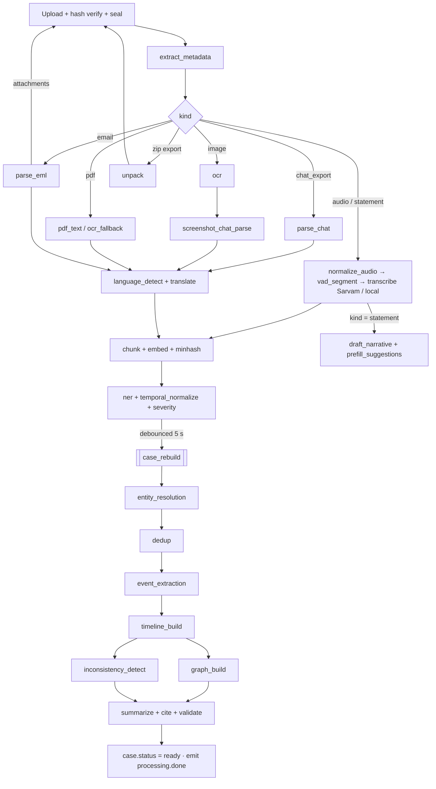

# SPEC — TraceVault: AI-Powered Digital Evidence Intelligence Platform

> **Build Beyond'26 · PS 3.2** · Companion to [prd.md](prd.md) (v1.0)
> Document status: spec v1.0 · Last updated: 2026-11-14
> **Where this spec and the PRD disagree, this spec wins.**

---

## 0. What changed from PRD v1.0

| Area | PRD v1.0 | This spec |
|------|----------|-----------|
| Deployment / dev env | Docker Compose (web, api, worker, ml, mongo, redis, minio) | **No Docker.** Every service runs natively as a process (Node, Python venv). One `npm run dev` starts all of them. |
| Speech-to-text | faster-whisper (local) | **Sarvam AI** (`saaras:v4`, `mode=transcribe` for the spoken language and `mode=translate` for English) is the primary engine. faster-whisper stays only as the offline fallback for `local` privacy mode. |
| Voice features | Transcription only; voice intake listed as future scope | Voice is a first-class feature set (§6): evidence transcription, diarization, voice statement intake, voice Q&A, read-aloud summaries in Indian languages. |
| Translation | Not specified (English-centric NLP) | **Sarvam Translate** turns non-English chunks into an English working copy for NER/NLI/LLM; originals are always shown and cited. |
| Job queue | BullMQ + Redis | **MongoDB-backed job runner** (`jobs` collection). Removes Redis as a dependency. |
| Object storage | MinIO / S3 with Object Lock | **GridFS** (in MongoDB), encrypted. S3/R2 with Object Lock is an optional production upgrade. |
| ML file access | Presigned MinIO URLs | Node streams the decrypted bytes to the ML service as multipart; the ML service still has no DB access. |
| Diarization | P2 (pyannote) | **P1**, via Sarvam's batch STT with diarization. |
| Demo dataset voice notes | Generic TTS | Generated with **Sarvam Bulbul** TTS (Hindi + English + one regional language). |

Everything else in the PRD (goals, roles, integrity design, algorithms, evaluation targets) still applies and is restated or referenced below.

---

## 1. Product summary

TraceVault turns a victim's scattered digital evidence (WhatsApp exports, screenshots, voice notes, PDFs, emails, bank statements) into a **sealed, verifiable, cited case file**:

1. **Preserve**: every original is hashed (SHA-256) in the browser and on the server, encrypted, and written to an append-only, hash-chained audit log.
2. **Extract**: text, people, phones, UPI IDs, amounts, dates and locations, via OCR, Sarvam speech-to-text and NLP, in English, Hindi, Hinglish and other Indian languages.
3. **Link**: one identity per real person across sources; duplicates detected across formats.
4. **Reconstruct**: one chronological timeline.
5. **Flag**: inconsistencies such as edited screenshots, conflicting dates and mismatched amounts.
6. **Summarize**: every sentence cites its source, and a validator checks it.
7. **Visualize**: an interactive relationship graph.
8. **Share and export**: time-limited access for lawyers and police; a report PDF with hashes and a draft Section 63 BSA certificate; an offline-verifiable evidence bundle.
9. **Speak**: victims can tell their story by voice in their own language, ask questions by voice, and hear summaries read aloud.

---

## 2. Users and roles

| Role | Who | Can do |
|------|-----|--------|
| **Owner** | Victim / complainant | Everything on their own cases: upload, record statements, annotate, merge entities, change privacy settings, share, export, delete derived data, delete a case (crypto-shred) |
| **Collaborator** | Trusted friend or family member | Upload, record statements, annotate, merge/split entities, edit events, on cases they are invited to. Cannot share, export or change privacy settings |
| **Legal** | Lawyer / NGO counsellor | Read (scoped), annotate, explain inconsistencies, export the report. Access expires |
| **Investigator** | Police cyber cell | Read (scoped), verify integrity, export report and bundle. Access expires |
| **Admin** | Platform operator | Manage users, view system health and job queue. **No access to case content** unless an Owner grants it |

RBAC is enforced twice: route middleware (`requireCaseRole(...)`) and query filtering (`caseId ∈ user.accessibleCases`, plus evidence scope for shared users).

---

## 3. Architecture (no Docker)



### 3.1 Processes

| Process | Command | Port | Notes |
|---------|---------|------|-------|
| `web` | `npm run dev -w apps/web` | 5173 | Vite dev server; proxies `/api` and `/socket.io` to 4000 |
| `api` | `npm run dev -w apps/api` | 4000 | Express + Socket.IO + job runner in the same process (`WORKER_IN_PROCESS=true`) |
| `worker` (optional) | `npm run worker -w apps/api` | — | Same code with `WORKER_IN_PROCESS=false` on the API; progress is relayed to the API over an internal HTTP endpoint |
| `ml` | `uvicorn app.main:app --port 8000` (inside `services/ml/.venv`) | 8000 | Binds to `127.0.0.1` only; requires the `X-Internal-Secret` header |
| `mongod` | Local install started as a single-node replica set, **or** MongoDB Atlas (free M0) | 27017 | A replica set is required for transactions (audit chain) |

The root `package.json` runs `web`, `api` and `ml` together with `concurrently`:

```bash
npm run dev
```

### 3.2 Why it is split this way
- **Node/Express** owns users, permissions, integrity guarantees, storage, jobs and the public API.
- **Python FastAPI** is stateless: it receives bytes or text and returns JSON. It is the only component that talks to Sarvam and the LLM.
- **MongoDB** holds everything: documents, embeddings, the audit chain, GridFS file blobs and the job queue. One database to install and back up.

### 3.3 Job runner (replaces BullMQ)
- Collection `jobs`: `{ _id, type, caseId, evidenceId?, key, status: 'queued'|'running'|'done'|'failed', attempts, maxAttempts: 3, runAt, lockedBy?, lockedUntil?, progress, error?, result?, createdAt }`.
- **Claim**: `findOneAndUpdate({status:'queued', runAt ≤ now, type ∈ handledTypes}, {$set:{status:'running', lockedBy, lockedUntil: now+5min}})`, sorted by `runAt`.
- **Concurrency per type**: `ocr: 4`, `transcribe: 3` (Sarvam calls are network-bound), `transcribe_local: 1`, `nlp: 4`, `case_*: 1 per case`, others `8`.
- **Retries**: exponential backoff (`runAt = now + 2^attempts × 5s`); after 3 failures the step is `failed` and the rest of the case keeps processing.
- **Idempotency**: unique index on `key = {evidenceId|caseId}:{step}:{generatorVersion}`.
- **Debounce of case-level jobs**: upsert a `case_rebuild` job with `runAt = now + 5s` on every per-evidence completion; the upsert pushes `runAt` forward, so 20 uploads trigger one rebuild.
- **Crash recovery**: on startup, jobs with `status:'running'` and `lockedUntil < now` go back to `queued`.
- **Admin view**: `/admin/jobs` lists queued/running/failed jobs with retry buttons (replaces bull-board).

---

## 4. Tech stack

| Layer | Choice |
|-------|--------|
| Frontend | React 18, Vite, TypeScript, Tailwind CSS, shadcn/ui, lucide-react |
| State / data | TanStack Query, Zustand, React Router v6 |
| Timeline | vis-timeline |
| Graph | Cytoscape.js + cytoscape-fcose |
| Viewers | react-pdf; canvas overlay for OCR boxes; wavesurfer.js for audio + transcript sync |
| Uploads / hashing | react-dropzone; hash-wasm (streaming SHA-256 in a Web Worker) |
| Voice capture | MediaRecorder API (`audio/webm;codecs=opus`), with a live level meter |
| Realtime | Socket.IO |
| Backend | Node 20, Express, Zod, Mongoose, `multer` (streaming), `file-type` |
| Auth / security | jsonwebtoken, argon2, helmet, cors, express-rate-limit, otplib (P2) |
| Crypto | Node `crypto` (SHA-256, AES-256-GCM, Ed25519) |
| Storage | MongoDB GridFS (encrypted blobs). Optional: S3 / Cloudflare R2 with Object Lock |
| Reports | Puppeteer (bundled Chromium), archiver (ZIP) |
| ML service | Python 3.11, FastAPI, Uvicorn, Pydantic, httpx |
| **Voice (primary)** | **Sarvam AI** over raw HTTPS with `httpx` (no SDK dependency): Saaras v4 (`/speech-to-text`, modes `transcribe`/`translate`), Mayura (`/translate`), Bulbul v3 (`/text-to-speech`), `/text-lid` |
| Voice (offline fallback) | faster-whisper `small` (CPU) — used only in `local` privacy mode |
| Audio processing | ffmpeg (convert `.opus/.ogg/.m4a/.mp3/.webm` → 16 kHz mono WAV), silero-vad / webrtcvad for segmenting |
| OCR | PaddleOCR (`en`, `devanagari`); Tesseract 5 `eng+hin` fallback |
| NLP | spaCy `en_core_web_trf`, GLiNER (multilingual), dateparser, phonenumbers, rapidfuzz |
| Embeddings | `intfloat/multilingual-e5-small` |
| NLI | `cross-encoder/nli-deberta-v3-base` |
| Severity | detoxify / `unitary/toxic-bert` + LLM labels |
| Dedup | imagehash (pHash/dHash), datasketch (MinHash LSH) |
| Metadata | Pillow / exifread, PyMuPDF, Python `email` |
| Graph analytics | networkx (centrality, Louvain communities) |
| LLM | Claude API: `claude-haiku-5-5` (extraction), `claude-sonnet-5-5` (summaries, Q&A). Local fallback: Ollama (Llama/Qwen 7–8B) |
| Testing | Vitest + React Testing Library, Jest + Supertest, Pytest |
| Process management | `concurrently` (dev); `pm2` (demo/prod box) |

---

## 5. Feature specification

Priority: **P0** = required for the demo · **P1** = should have · **P2** = stretch goal.
Each feature lists acceptance criteria (**AC**) that define "done".

### 5.1 Authentication and accounts (A)

| ID | Feature | P |
|----|---------|---|
| A1 | Email + password registration and login | P0 |
| A2 | Short-lived JWT + rotating refresh token | P0 |
| A3 | Case-scoped RBAC middleware | P0 |
| A4 | Rate limiting on auth, upload, voice and LLM routes | P1 |
| A5 | TOTP two-factor authentication | P2 |
| A6 | User profile: name, preferred UI language, preferred voice language | P1 |

**AC**
- Passwords are hashed with argon2id; plain passwords never appear in logs.
- Access JWT expires in 15 min; refresh token is in an `httpOnly; Secure; SameSite=Strict` cookie, rotated on every use; reuse of an old refresh token revokes the whole token family.
- A user without a role on a case gets `404` (not `403`) for every route of that case, so case IDs can't be probed.
- More than 10 failed logins per IP per 15 min returns `429`.

### 5.2 Case management (C)

| ID | Feature | P |
|----|---------|---|
| C1 | Create, list, view, update, delete cases (title, incident type, description, tags, status) | P0 |
| C2 | Case overview dashboard: counts (evidence, people, events, inconsistencies, duplicates), processing progress, key moments, mini timeline, top entities | P0 |
| C3 | Case privacy settings: LLM mode and voice processing mode (§5.12) | P0 |
| C4 | Case timezone (default `Asia/Kolkata`) | P1 |
| C5 | Crypto-shred delete: derived data purged, wrapped keys destroyed, tombstone audit entry keeps the hashes | P1 |
| C6 | Case "seal": freezes the evidence set; further uploads go into a new, linked addendum | P2 |

**AC**
- Incident types: `harassment`, `fraud`, `stalking`, `sextortion`, `other`.
- Status moves `draft → processing → ready`, and back to `processing` on any new upload or correction.
- Delete requires typing the case title; after delete, originals can't be decrypted and the audit log keeps a `CASE_DELETED` tombstone with the Merkle root.

### 5.3 Evidence upload and management (E)

| ID | Feature | P |
|----|---------|---|
| E1 | Multi-file drag-and-drop upload | P0 |
| E2 | Client-side SHA-256 (Web Worker, streaming) shown before upload | P0 |
| E3 | Server-side re-hash, comparison, sealing (encrypt + store in GridFS) | P0 |
| E4 | Exact-duplicate warning when the same hash already exists in the case | P0 |
| E5 | Originals immutable: no update route; removal only via an audited redact request that keeps a hash tombstone | P0 |
| E6 | Evidence library: grid/table, filters by kind, source, person, date, severity; duplicates collapsed under the canonical item | P0 |
| E7 | Evidence viewer (§5.11) | P0 |
| E8 | Source grouping labels (e.g. "WhatsApp – Rahul chat") | P1 |
| E9 | Notes, tags and annotations per evidence item, stored separately from the original | P1 |
| E10 | Reprocess an evidence item (e.g. after switching voice provider) | P1 |
| E11 | Live per-file processing status via Socket.IO | P0 |

**AC**
- Supported formats: WhatsApp `.txt` (and `.zip` export with media), `.png/.jpg/.jpeg/.webp`, `.mp3/.ogg/.opus/.m4a/.wav/.webm`, `.pdf`, `.eml`. Type is detected from magic bytes, not the extension.
- Max 200 MB per file, 50 files per case for the MVP.
- If `clientSha256 ≠ serverSha256`, the upload is rejected with `HASH_MISMATCH` and nothing is stored.
- Every upload writes an `EVIDENCE_UPLOADED {evidenceId, sha256, size, mime}` audit entry.
- A WhatsApp `.zip` export is unpacked server-side: the `.txt` becomes `chat_export`, and each media file becomes child evidence linked by `parentEvidenceId` and auto-linked to its `<attached: …>` placeholder message.

### 5.4 Ingestion and extraction (I)

| ID | Feature | P |
|----|---------|---|
| I1 | WhatsApp export parser (Android + iOS formats, multi-line messages, media placeholders, DD/MM vs MM/DD detection) | P0 |
| I2 | Image OCR with per-line bounding boxes (English + Hindi/Devanagari), dark-mode handling | P0 |
| I3 | Screenshot → chat messages (bubble clustering, sender by alignment, header contact name, in-bubble times; LLM fallback) | P1 |
| I4 | **Audio transcription via Sarvam** (§6.1) | P0 |
| I5 | PDF text extraction, OCR fallback for scanned pages | P0 |
| I6 | `.eml` parsing, attachments processed recursively as child evidence | P1 |
| I7 | Metadata extraction: EXIF (capture time, GPS, device, software), PDF metadata, email headers, file times | P0 |
| I8 | **Language detection and translation of non-English text chunks via Sarvam** (§6.3) | P0 |
| I9 | Telegram JSON export parser | P2 |
| I10 | Instagram/Google Takeout JSON message import | P2 |

**AC**
- Parsing rules, regexes and preprocessing are as in PRD §10.1–10.2.
- Every derived artifact records `sourceSha256` and `generator {name, version, model, provider}`.
- OCR lines with confidence < 0.6 are flagged "low confidence" in the viewer.
- A PDF page with < 50 characters of text is rendered at 300 DPI and OCR'd.

**Chunking** (each chunk is the atomic unit of citation, `[E{evidenceIdx}:{chunkIdx}]`):

| Source | Chunk unit | Locator |
|--------|-----------|---------|
| Chat export | 1 message (multi-line merged) | `messageIdx`, `lineNo` |
| Screenshot | 1 chat bubble, or 1 OCR block | `bbox` |
| Audio | 1 speech segment (VAD-bounded, ≤ 25 s) | `startMs`, `endMs`, `speaker?` |
| PDF | 1 paragraph (≤ 800 chars) | `page`, `bbox?` |
| Email | Header block + body paragraphs | `part`, `paragraphIdx` |
| Voice statement | 1 speech segment | `startMs`, `endMs` |

### 5.5 Intelligence (N)

| ID | Feature | P |
|----|---------|---|
| N1 | Named-entity extraction: PERSON, PHONE, EMAIL, HANDLE, ORG, LOCATION, MONEY, UPI_ID, BANK_ACCT, URL, DATE/TIME, VEHICLE_NO, ADDRESS | P0 |
| N2 | Temporal normalization ("kal raat 9 baje", "yesterday at 9" → ISO, against the chunk's reference time) | P0 |
| N3 | Entity resolution across sources with merge/split and must-link / cannot-link constraints | P0 |
| N4 | Duplicate detection: exact, near-image, near-text, cross-modal | P0 |
| N5 | Event extraction into `TimelineEvent`s (actor, action, target, time, location, amount, category) | P0 |
| N6 | Severity / harm classification (threat, sexual, extortion, abuse, financial request, benign → 0–3) | P1 |
| N7 | Inconsistency detection (rules + NLI) | P0 |
| N8 | Relationship graph construction and analytics | P0 |
| N9 | Cited case summary with citation validation | P0 |
| N10 | Natural-language Q&A over the case, with citations (typed or by voice) | P1 |
| N11 | Pattern insights: escalation trend, message-frequency heatmap (day × hour), first contact, peak hours, response gaps | P1 |

**AC (key thresholds; algorithms in PRD §10.4–10.12)**
- **NER**: merged by span overlap with priority regex > GLiNER > spaCy. Regex runs on the **original** text; spaCy runs on the **English working copy** (`textEn`); GLiNER runs on the original. Mention spans always point into the original text.
- **Temporal**: reference time priority = chat/email header > EXIF > OCR'd in-image time > upload time. Vague expressions get `tsPrecision: 'approx'` and render as range bars.
- **Entity resolution**: pairs with `s ≥ 0.85` auto-merge; `0.65 ≤ s < 0.85` become `SAME_AS_CANDIDATE` suggestions; manual decisions survive every rebuild.
- **Dedup**: pHash ≤ 8 and dHash ≤ 10; MinHash Jaccard ≥ 0.8; cross-modal = embedding cosine ≥ 0.9 **and** edit similarity ≥ 0.85 **and** timestamps within ±2 min. Duplicates are grouped, never deleted. A cross-modal pair with cosine ≥ 0.9 but edit similarity < 0.85 raises `CONTENT_CONTRADICTION`.
- **Events**: the LLM must cite input chunk IDs; any ID not in the input is rejected. Offline fallback: every chunk with severity ≥ 1 or a MONEY/LOCATION entity becomes an event.
- **Severity**: drives timeline colour and "key moments" (top 5 by severity × confidence).
- **Targets**: entity F1 ≥ 0.85; ER pairwise F1 ≥ 0.85; dedup P ≥ 0.9 / R ≥ 0.8.

### 5.6 Timeline (T)

| ID | Feature | P |
|----|---------|---|
| T1 | Chronological timeline with lanes by source or by person | P0 |
| T2 | Severity colours; approximate times as range bars | P0 |
| T3 | Filters: date range, person, category, minimum severity, source | P0 |
| T4 | Event drawer: description, actors, citations (with preview), confidence, "corroborated by N sources" | P0 |
| T5 | Edit event (time, title, category); audited, `userEdited=true`, survives rebuilds | P0 |
| T6 | Clicking an audio-sourced event plays the exact segment of the voice note | P0 |
| T7 | Cross-source event merging (shared actors, ±10 min, embedding sim ≥ 0.85) | P0 |
| T8 | Missing-time inference from neighbours in the same source, shown as approximate | P1 |
| T9 | Complainant-statement events shown in a separate "Your account" lane (§6.4) | P1 |

**AC**: Kendall's τ ≥ 0.85 and ≥ 80% of events within ±5 min of ground truth on the demo case.

### 5.7 Relationship graph (G)

| ID | Feature | P |
|----|---------|---|
| G1 | Nodes: people/accounts (sized by mentions), evidence (icon by kind), locations, money/UPI; optional event layer | P0 |
| G2 | Edges: `MESSAGED`, `CALLED`, `PAID`, `THREATENED`, `MENTIONED_IN`, `APPEARS_WITH`, `SAME_AS_CANDIDATE` (dashed) | P0 |
| G3 | Time slider filtering edges by `firstTs..lastTs` | P1 |
| G4 | Click an edge or node → cited messages | P0 |
| G5 | Centrality sizing ("central figures") and Louvain community colours (mule-account clusters) | P1 |
| G6 | Accept / reject merge suggestions directly from the graph | P1 |
| G7 | Export the graph as PNG for the report | P2 |

### 5.8 Inconsistencies (X)

| ID | Feature | P |
|----|---------|---|
| X1 | Rule checks: `METADATA_MISMATCH`, `EDITED_FILE`, `DATE_CONFLICT`, `AMOUNT_MISMATCH`, `SENDER_MISMATCH`, `IMPOSSIBLE_SEQUENCE` | P0 |
| X2 | NLI contradiction check across evidence items sharing an entity (top 200 pairs, contradiction ≥ 0.85) | P0 |
| X3 | Side-by-side cards with both sources, severity, a one-line LLM explanation limited to the two quoted texts | P0 |
| X4 | Dismiss or explain with a note (audited); explained items appear in the report with the note | P0 |
| X5 | Statement-vs-evidence check: flags where the victim's voice statement conflicts with documentary evidence (e.g. a different date), so they can correct it before filing | P1 |

**AC**: catches all 3 planted inconsistencies in the demo case with ≤ 3 false positives.

### 5.9 Summaries and Q&A (S)

| ID | Feature | P |
|----|---------|---|
| S1 | Sectioned summary: Overview, Parties involved, Chronology, Threats & harm, Financial loss, Inconsistencies & gaps | P0 |
| S2 | Every sentence ends with citations; citation IDs validated against the case and the provided context | P0 |
| S3 | NLI support check (entailment ≥ 0.7) → ⚠ "not fully supported" badge, or regenerate once | P0 |
| S4 | Citation chips with hover preview (image crop with bbox, audio snippet, chat bubble) and click-through to the viewer | P0 |
| S5 | Regenerate summary (owner) | P0 |
| S6 | Q&A box: typed questions → cited answers | P1 |
| S7 | Voice Q&A and read-aloud (§6.5, §6.6) | P2 |
| S8 | Summary in the user's language (Sarvam Translate of the validated English summary; citations unchanged) | P1 |
| S9 | Per-person summary ("Everything about Rahul K") | P2 |

**AC**: 100% of shown sentences carry a valid citation; ≥ 90% are NLI-supported; no unsupported sentence is shown without a ⚠.

### 5.10 Integrity, security and audit (V)

| ID | Feature | P |
|----|---------|---|
| V1 | SHA-256 of every original at upload, re-verifiable on demand | P0 |
| V2 | Hash-chained, append-only audit log for every action | P0 |
| V3 | "Verify integrity": rehash all originals from GridFS + recompute the chain + check signatures → green/red report naming the first broken entry or file | P0 |
| V4 | Per-case Merkle root over evidence hashes; Merkle proof per file | P1 |
| V5 | AES-256-GCM envelope encryption of originals (per-file data key wrapped by a master KEK) | P1 |
| V6 | Ed25519-signed checkpoints every 50 entries and at every export | P1 |
| V7 | Public timestamp anchoring of the Merkle root (OpenTimestamps) | P2 |
| V8 | PII redaction before cloud LLM/translation calls (`cloud_redacted` mode) | P1 |
| V9 | ClamAV scan on upload (native Windows/Linux install) | P2 |

**Audit chain**
```
entry_n = { caseId, seq:n, ts, actorId, actorRole, action, target, payloadHash }
hash_n  = SHA256( hash_{n-1} || canonicalJSON(entry_n) )      // hash_0 = SHA256("TRACEVAULT_GENESIS:" + caseId)
```
- Writes are serialized per case in a MongoDB transaction with a unique `(caseId, seq)` index (needs a replica set).
- **Audited actions**: login, case create/update/delete, upload, record statement, view evidence, download, annotate, entity merge/split, event edit, duplicate verdict, dismiss/explain inconsistency, regenerate summary, ask (question hash only), TTS playback generation, privacy setting change, share create/accept/revoke, export, verify.

**Storage without Object Lock**: immutability comes from (a) no update/delete routes for originals, (b) the GridFS bucket written only by the upload service, (c) hash + Merkle verification, (d) the audit chain. Production upgrade: S3/R2 bucket with Object Lock in compliance mode.

**Demo moment**: edit one byte of an audit entry in MongoDB Compass (or overwrite a GridFS chunk), click Verify → the report turns red at the exact entry/file.

**Application security**: HTTPS + HSTS in production; helmet CSP with `frame-ancestors 'none'`; Zod validation on every body; magic-byte sniffing; uploads never served from a static path, only through authenticated, short-TTL, audited stream URLs; no evidence content in logs (pino with redaction); secrets only in `.env` (never committed).

### 5.11 Evidence viewer (W)

| ID | Feature | P |
|----|---------|---|
| W1 | Original on the left, extracted text on the right with entity highlights | P0 |
| W2 | Images: OCR boxes overlaid; click a box ↔ highlight its text | P0 |
| W3 | PDFs: page view with text layer; OCR'd pages marked | P0 |
| W4 | Audio: waveform (wavesurfer), synced transcript (current segment highlighted, click-to-seek), speaker labels, language badge, original-language transcript with an English translation toggle | P0 |
| W5 | Chat exports: rendered as a chat UI with sender sides, timestamps, media placeholders linked to child evidence | P0 |
| W6 | Metadata panel (EXIF, PDF meta, headers) with red flags (e.g. `Software: Snapseed`) | P0 |
| W7 | Hash badge + "verify this file" button | P0 |
| W8 | Trauma-informed defaults: blur images and mask abusive words until clicked; content warning before severity-3 content | P1 |
| W9 | Viewer-identity watermark for shared users | P1 |

### 5.12 Privacy modes (P)

Per-case setting, changeable only by the Owner, audited.

| Setting | Values | Effect |
|---------|--------|--------|
| `llmMode` | `cloud` · `cloud_redacted` · `local` | `cloud`: Claude API. `cloud_redacted`: PII replaced with placeholders (`⟦PERSON_1⟧`, `⟦PHONE_2⟧`) before sending, restored on return. `local`: Ollama; nothing leaves the server. |
| `voiceMode` | `sarvam` · `local` | `sarvam`: audio sent to Sarvam AI for STT/translation/TTS. `local`: faster-whisper offline; no translation; no TTS. |
| `translateMode` | `sarvam` · `sarvam_redacted` · `off` | How non-English text chunks get an English working copy. |

**AC**
- New cases default to `llmMode=cloud_redacted`, `voiceMode=sarvam`, `translateMode=sarvam_redacted`, and the Owner sees a one-screen consent explaining which providers receive what.
- **Audio cannot be redacted before STT.** Choosing `voiceMode=sarvam` requires an explicit consent checkbox ("Voice notes will be sent to Sarvam AI, an Indian speech provider, for transcription"); without it the case falls back to `local`.
- Switching `llmMode=local` forces `voiceMode=local` and `translateMode=off` unless the Owner re-enables them.
- Prompts and provider responses are never stored in our DB; only `promptVersion`, model, provider and an input hash are recorded.

### 5.13 Sharing (H)

| ID | Feature | P |
|----|---------|---|
| H1 | Create a share grant: recipient email, role (Legal / Investigator), scope (whole case or selected evidence), expiry, allow download | P0 |
| H2 | Invite link with a 32-byte token (only its SHA-256 stored); grant binds to the recipient's user ID on accept | P0 |
| H3 | Scoped views hide out-of-scope evidence everywhere (timeline, graph, summary citations show "restricted") | P0 |
| H4 | Revoke; view logging; view counts shown to the Owner | P0 |
| H5 | Watermark `Viewed by {email} · {timestamp} · Case {id}` on viewer and exports | P1 |

### 5.14 Reports and export (R)

> **Implementation status (2026-11-14):** R1, R2, R3 and R4 are implemented (`apps/api/src/routes/export.js`, `services/export.js`). Deviations: the PDF is rendered by PyMuPDF's HTML engine in the ML service (`/report/pdf`) instead of Puppeteer, which needs no Chromium download and falls back to embedded Noto fonts for Hindi/Kannada. Exports are role-gated: owner all; legal report + certificate; investigator all, with the bundle needing a grant that allows downloads. Shared users only ever export evidence inside their grant's scope. Every export page carries the viewer watermark, and every export is audited with the file's SHA-256. The bundle is refused with `INTEGRITY_FAILED` if the audit chain or any original fails verification, so a signature is never placed over altered records; `checkpoint.json` is Ed25519-signed (V6) and `verify.py` re-checks files, Merkle root, audit chain and signature offline. Not built: R5 (regional-language report copy).

| ID | Feature | P |
|----|---------|---|
| R1 | Case report PDF (Puppeteer render of a React print view): summary, timeline, inconsistencies (with explanations), evidence index with SHA-256, Merkle root, audit head hash, signed checkpoint | P0 |
| R2 | Evidence bundle ZIP: originals, `manifest.json`, `audit.jsonl`, public key, offline `verify.py` | P1 |
| R3 | Prefilled Section 63 BSA certificate draft (Part A/B fields, hash values), clearly labelled as a draft to assist | P1 |
| R4 | Transcripts appendix: original-language transcript + English translation for each audio item, with provider/model noted | P1 |
| R5 | Report in English plus an optional regional-language copy of the summary section | P2 |

### 5.15 Admin and operations (O)

| ID | Feature | P |
|----|---------|---|
| O1 | Admin: list/disable users; no case content access | P1 |
| O2 | Jobs dashboard: queued/running/failed, retry, per-step timings | P1 |
| O3 | `/health` on API and ML (DB, GridFS, model load status, GPU, Sarvam reachability and key validity, Claude reachability) | P0 |
| O4 | Sarvam usage meter: seconds of audio transcribed and characters translated/synthesized per day, with a configurable soft cap | P1 |
| O5 | Seed script that loads the demo case | P0 |

---

## 6. Voice AI with Sarvam

Sarvam is used for everything speech-related and for Indian-language translation. All Sarvam calls go through one module, `services/ml/app/voice/sarvam_client.py`, so model names, retries, rate limits and usage metering live in one place.

> **Model names change.** Defaults below are configurable through env vars (§9). Checked against Sarvam's docs on 2026-11-14: `saaras:v4` serves both transcription and speech→English through one `/speech-to-text` endpoint (`mode=transcribe|translate`); the older Saarika + `/speech-to-text-translate` pair is legacy. Responses carry `transcript`, `language_code`, `language_probability`; timestamps are phrase-level only (no word timestamps). TTS is `bulbul:v3` (≤ 2,500 chars per request, response `audios[]` base64).
>
> **Implementation status (2026-11-14):** §6.1 (minus batch diarization), §6.3 routes, §6.6 synthesis route and §6.8 are implemented in `services/ml/app/voice/` + `app/lang/` + `app/routers/voice.py`, with tests in `services/ml/tests/test_voice.py`. Not yet built: §6.2 diarization (batch job API), §6.4 narrative/suggestions, §6.7 dataset generator, and the Node side (job handler, `providerUsage` persistence, routes in §10.1).

### 6.1 Evidence audio transcription (V-STT) · P0

**Input**: any audio evidence (`.opus/.ogg/.m4a/.mp3/.wav/.webm`), including WhatsApp voice notes and media from `.zip` exports.

**Flow**
1. **Normalize**: ffmpeg → 16 kHz mono PCM WAV. Keep the original untouched; the WAV is a temporary derived file.
2. **Segment**: VAD splits speech into segments of ≤ 25 s (Sarvam's synchronous STT accepts short clips; merge very short segments, split long ones at the lowest-energy point). Each segment keeps `startMs/endMs` relative to the original file.
3. **Transcribe** (parallel, concurrency 3 segments, both calls per segment concurrent):
   - `SARVAM_STT_MODEL` (default `saaras:v4`) with `mode=transcribe, language_code=unknown` → native-script transcript + detected language code (e.g. `hi-IN`, `kn-IN`, `en-IN`) + `language_probability`.
   - Same model with `mode=translate` on the same segment → English transcript (the English working copy used by NLP).
   - If the translate call fails, fall back to Sarvam Translate on the original transcript (§6.3); English audio uses its own transcript as `textEn`.
   - Segment timing comes from our VAD, not from Sarvam (Sarvam only gives phrase-level timestamps). Seek precision is therefore segment-level; ±1 s word-level seek needs local whisper word timestamps or shorter segments.
4. **Long files / diarization**: audio longer than `SARVAM_BATCH_THRESHOLD_SEC` (default 120 s), or when the Owner asks for speaker labels, uses Sarvam's **batch STT job API with diarization**. Its speaker turns become segments with `speaker: 'SPEAKER_1'|…`. Users can rename speakers ("SPEAKER_2 = Rahul"), which links the speaker to an entity.
5. **Persist**: a `transcript` derived artifact `{lang, provider:'sarvam', model, segments:[{startMs, endMs, speaker?, text, textEn, words?}]}`; one chunk per segment with `text` (original), `textEn`, `lang`, `locator.startMs/endMs`.
6. **Fallback**: on `voiceMode=local`, a Sarvam outage (after 3 retries), or a missing API key, the job uses faster-whisper `small` with `word_timestamps=True, vad_filter=True`. The artifact records `provider:'local_whisper'` and the viewer shows a "local transcription" badge.

**AC**
- WER ≤ 15% on the demo voice notes (Hindi, English, Hinglish).
- Clicking a transcript segment or a timeline event seeks to within ±1 s of the spoken words.
- Detected language is shown per segment; code-mixed audio shows the dominant language.
- A failed segment doesn't fail the file: the segment is marked `[untranscribed]` with a retry button.

### 6.2 Speaker diarization (V-DIAR) · P1

- Via Sarvam batch STT with diarization (see 6.1 step 4), optional `num_speakers` hint from the user.
- Speaker → entity linking: manual ("this voice is Rahul") or automatic when the transcript contains a self-identification ("main Rahul bol raha hoon") and ER resolves it with confidence ≥ 0.85.
- Diarized turns feed the graph (`CALLED` / `MESSAGED` edges for call recordings) and the timeline actor field.

### 6.3 Text language detection and translation (V-TRANS) · P0

- Every non-audio chunk (chat message, OCR block, PDF paragraph, email paragraph) goes through language identification: a fast local heuristic (script detection + `langid`) first; Sarvam text LID only when ambiguous (romanized Hinglish).
- Chunks whose language isn't English get `textEn` from **Sarvam Translate** (`SARVAM_TRANSLATE_MODEL`, default `mayura:v1`), batched by language, preserving placeholders.
- In `translateMode=sarvam_redacted`, PII is replaced with `⟦TYPE_n⟧` tokens before sending and restored afterwards; tokens that come back missing or altered cause a retry, then fall back to the untranslated text.
- English chunks and romanized Hinglish that the English models handle acceptably (LID confidence < threshold) skip translation to save cost.
- UI: every non-English chunk shows the original by default with a "Show English" toggle. Citations, quotes in inconsistency cards and the report always quote the **original** text, with the translation beside it, labelled "machine translation (Sarvam)".

**AC**: NER F1 on Hindi/Hinglish chunks is within 0.05 of English chunks on the demo case.

### 6.4 Voice statement intake ("Tell what happened") (V-INTAKE) · P1

> **Implementation status (2026-11-14):** implemented end to end: recorder with pause/resume, level meter, listen-back and re-record (`VoiceStatementPage.tsx`); upload as `kind=statement` (`STATEMENT_RECORDED`); transcription; a `narrative` job that stores versioned drafts (`statements` collection) with per-sentence citations; edits saved as new versions (`STATEMENT_EDITED`, audited by hash); owner-chosen suggestion apply (`STATEMENT_SUGGESTIONS_APPLIED`); the “Your account” timeline lane and the statement-vs-evidence check (X5). Without an LLM the draft is the cleaned transcript, supported by construction; with one, cited ids are validated and unsupported sentences dropped. Drafts are in English and the spoken language (not a separately translated native narrative). Real microphone capture was not testable in the automated browser pane.

A trauma-informed way for the victim to give their account in their own language without typing.

- On the case page, **Record statement** opens a recorder: start/pause/resume/stop, level meter, elapsed time, and an option to re-record before saving. Optional guided prompts are shown (and read aloud with Bulbul if enabled): "When did it start?", "Who is involved?", "Did you pay any money?", "Where did it happen?". Every prompt is skippable.
- The recording is uploaded like any evidence (client hash → server hash → seal → audit `STATEMENT_RECORDED`) with `kind: 'statement'`.
- It is transcribed with §6.1 and then:
  - **Draft narrative**: the LLM turns the transcript into a first-person written statement in the user's language and English, with every sentence citing a transcript segment. The user can edit it; edits are versioned and audited.
  - **Case prefill suggestions**: incident type, people mentioned, phone numbers, amounts, dates. Shown as suggestions; nothing is applied without a click.
  - **Statement events**: events extracted from the statement go to the "Your account" timeline lane with `sourceType: 'self_statement'`.
- **Evidentiary rule**: a self-statement never corroborates itself. It doesn't raise the confidence of events supported only by other self-statements, and the summary labels such facts "according to the complainant".
- Statements feed the statement-vs-evidence inconsistency check (X5).

**AC**: a 3-minute Hindi statement is transcribed, drafted and shown with suggestions in under 60 s on the demo machine.

### 6.5 Voice Q&A (V-ASK) · P2

- A mic button in the Q&A box records a question (≤ 30 s), sends it to `POST /cases/:id/ask/voice`.
- Saaras (`mode=transcribe`) transcribes it (language auto-detected); the question is answered through the normal cited Q&A pipeline (N10) in English, then translated back to the question's language with Sarvam Translate.
- The answer is shown as text with citation chips and, if `voiceMode=sarvam`, spoken with Bulbul TTS (§6.6).
- The question audio is **not stored**: it is discarded after transcription. The audit entry stores only the question text's hash.

### 6.6 Read-aloud summaries and answers (V-TTS) · P2

- A **Listen** button on the summary page and on each Q&A answer, with a language picker (English + Sarvam-supported Indian languages) and a voice picker.
- The validated summary is translated (if needed), stripped of citation markers, split to Sarvam's per-request text limit at sentence boundaries, synthesized with **Bulbul** (`SARVAM_TTS_MODEL`, default `bulbul:v3`), and concatenated.
- The audio player highlights the sentence being read; citations stay clickable in the text.
- Generated audio is cached per `(summaryId, lang, voice)` in GridFS as a derived artifact, so the same summary isn't synthesized twice; it is deleted when the summary is regenerated.
- Severity-3 content is introduced with a spoken content warning before it is read.

### 6.7 Demo-dataset voice generation (V-DATA) · P0 (tooling)

- `eval/generate_case.py` uses Bulbul to synthesize the demo voice notes from scripted lines (Hindi threat with a location, English money demand, one Kannada note), then converts them to `.opus` to mimic WhatsApp.
- The scripts' text is the STT ground truth for WER.

### 6.8 Sarvam client requirements

| Concern | Requirement |
|---------|-------------|
| Auth | `api-subscription-key` header from `SARVAM_API_KEY`; never sent to the browser |
| Timeouts | 30 s per sync call; batch jobs polled every 5 s up to 15 min |
| Retries | 3 attempts with exponential backoff on 429/5xx/timeouts; no retry on 4xx validation errors |
| Rate limiting | Client-side token bucket (`SARVAM_MAX_RPS`, default 5) shared across workers |
| Metering | Every call (including failed attempts) yields `{provider, endpoint, model, audioSeconds | chars, latencyMs, status}`. The ML service has no DB, so each response returns these as `usage` (for `/tts`, the `X-Provider-Usage` header) and Node writes them to `providerUsage`. No content is ever included |
| Soft cap | When the daily cap (`SARVAM_DAILY_AUDIO_SEC_CAP`) is reached, new jobs fall back to local transcription and the Owner is notified |
| Health | `/health` checks reachability with a tiny request at most once every 5 min |
| Testing | `SARVAM_MOCK=true` returns recorded fixtures so tests and offline dev don't call the API |

---

## 7. Processing pipeline



- Progress events over Socket.IO: `{caseId, evidenceId, step, status, pct, provider?}` (e.g. "Transcribing 2/3 · Sarvam").
- Corrections (merge/split, event edit, duplicate verdict, inconsistency status) enqueue a partial rebuild from the affected step onward.
- **Speed target**: 20-file demo case processed in < 3 min with a GPU or < 6 min on CPU. Sarvam moves STT off the local machine, so CPU-only laptops should hit the 3-minute target too.

---

## 8. Data model (MongoDB)

All collections from PRD §8.1 apply, with these changes.

```js
// cases — added settings
{ ..., timezone: 'Asia/Kolkata',
  settings: { llmMode: 'cloud'|'cloud_redacted'|'local',
              voiceMode: 'sarvam'|'local', voiceConsentAt?: Date, voiceConsentBy?: userId,
              translateMode: 'sarvam'|'sarvam_redacted'|'off',
              uiLanguage: 'en-IN'|'hi-IN'|..., ttsVoice?: String } }

// evidence — new kinds, GridFS storage, parent link
{ ..., kind: 'chat_export'|'image'|'audio'|'pdf'|'email'|'statement'|'archive'|'other',
  storage: { backend: 'gridfs'|'s3', fileId | key },
  parentEvidenceId?, durationMs?, detectedLang? }

// derivedArtifacts — new types, provider recorded
{ ..., type: 'ocr'|'transcript'|'parsed_chat'|'pdf_text'|'email_parsed'|'translation'|'narrative'|'tts_audio',
  generator: { name, version, model, provider: 'sarvam'|'local_whisper'|'paddleocr'|'claude'|'ollama'|... } }

// chunks — bilingual
{ ..., text /* original */, textEn?, lang, langConfidence,
  translation?: { provider, model, redacted: Boolean },
  speaker?, sourceType: 'document'|'self_statement',
  locator: { page?, bbox?, startMs?, endMs?, lineNo?, messageIdx?, part?, paragraphIdx? } }

// speakers (new) — diarization labels per audio item
{ caseId, evidenceId, label: 'SPEAKER_1', displayName?, entityId? }

// statements (new) — drafted narrative versions
{ caseId, evidenceId, version, lang, textNative, textEn,
  sentences: [{ text, citations: [chunkId] }], editedBy?, createdAt }

// jobs (new) — see §3.3

// providerUsage (new) — metering, no content
{ ts, caseId?, provider, endpoint, model, audioSeconds?, chars?, latencyMs, status }

// timelineEvents — added
{ ..., sourceType: 'document'|'self_statement', corroborationCount }
```

**Indexes** (in addition to the PRD): `jobs.key` (unique), `jobs.status+runAt+type`, `chunks.caseId+lang`, `speakers.evidenceId+label` (unique), `providerUsage.ts`.

---

## 9. Configuration (`.env.example`)

```bash
# --- api ---
PORT=4000
MONGO_URI=mongodb://127.0.0.1:27017/tracevault?replicaSet=rs0
JWT_ACCESS_SECRET=change-me
JWT_REFRESH_SECRET=change-me
MASTER_KEK_BASE64=            # 32 bytes, base64 — wraps per-file data keys
ED25519_PRIVATE_KEY_PEM_PATH=./keys/audit_ed25519.pem
ML_BASE_URL=http://127.0.0.1:8000
ML_INTERNAL_SECRET=change-me
WORKER_IN_PROCESS=true
MAX_UPLOAD_MB=200
WEB_ORIGIN=http://localhost:5173

# --- ml service ---
INTERNAL_SECRET=change-me
ANTHROPIC_API_KEY=
LLM_EXTRACT_MODEL=claude-haiku-5-5
LLM_SUMMARY_MODEL=claude-sonnet-5-5
OLLAMA_BASE_URL=http://127.0.0.1:11434
OLLAMA_MODEL=qwen2.5:7b-instruct

# --- sarvam (voice + translation) ---
SARVAM_API_KEY=
SARVAM_BASE_URL=https://api.sarvam.ai
SARVAM_STT_MODEL=saaras:v4         # used with mode=transcribe and mode=translate
SARVAM_TRANSLATE_MODEL=mayura:v1
SARVAM_TTS_MODEL=bulbul:v3
SARVAM_TTS_DEFAULT_SPEAKER=shubh
SARVAM_BATCH_THRESHOLD_SEC=120
SARVAM_MAX_RPS=5
SARVAM_DAILY_AUDIO_SEC_CAP=7200
SARVAM_MOCK=false

# --- local fallbacks ---
WHISPER_MODEL=small
FFMPEG_PATH=ffmpeg
TESSERACT_PATH=tesseract
```

---

## 10. API specification

Base `/api/v1` · `Authorization: Bearer <jwt>` · errors `{ error: { code, message } }`.

### 10.1 Public API (Node)

All PRD §12.1 routes apply. Additions and changes:

| Method | Path | Description | Roles |
|--------|------|-------------|-------|
| GET | `/me` | Profile incl. language preferences | any |
| PATCH | `/me` | Update name, `uiLanguage`, `voiceLanguage` | any |
| PATCH | `/cases/:id/settings` | `{llmMode, voiceMode, voiceConsent, translateMode, timezone}` (audited) | owner |
| POST | `/cases/:id/evidence` | Multipart (`file`, `clientSha256`, `sourceLabel`, `kind?`); `kind=statement` for recorded statements | owner, collaborator |
| GET | `/evidence/:eid/transcript` | Segments with `text`, `textEn`, `lang`, `speaker`, times | member (scoped) |
| PATCH | `/evidence/:eid/speakers/:label` | `{displayName, entityId?}` | owner, collaborator |
| POST | `/evidence/:eid/reprocess` | `{steps?, voiceProvider?: 'sarvam'|'local'}` | owner |
| GET | `/cases/:id/statements` | Statement drafts (latest versions) | owner, collaborator, legal |
| PATCH | `/statements/:sid` | Save an edited draft (new version, audited) | owner, collaborator |
| POST | `/statements/:sid/suggestions/apply` | Apply selected prefill suggestions | owner |
| GET | `/cases/:id/insights` | Escalation trend, heatmap, first contact, peak hours | member |
| POST | `/cases/:id/ask` | `{question, lang?}` → cited answer | member |
| POST | `/cases/:id/ask/voice` | Multipart `audio` → `{question, lang, answer, sentences[], audioUrl?}` | member |
| POST | `/cases/:id/summary/speak` | `{lang, voice}` → `{audioUrl, sentenceTimings[]}` | member |
| GET | `/cases/:id/summary?lang=` | Summary, translated if `lang` given | member |
| GET | `/admin/jobs` · POST `/admin/jobs/:jid/retry` | Job dashboard | admin |
| GET | `/admin/usage` | Provider usage (Sarvam, Claude) by day | admin |
| GET | `/health` | API + DB + ML + providers | public (no detail) / admin (detail) |

**Socket.IO** namespace `/cases`, room `case:{id}`: `processing.progress`, `processing.done`, `processing.error`, `summary.ready`, `statement.ready`, `provider.fallback` (e.g. Sarvam unavailable → local).

### 10.2 Internal ML API (Python, `127.0.0.1` only, `X-Internal-Secret`)

All PRD §12.2 routes apply, except that file inputs are **multipart `file`** instead of `fileUrl`. Changes and additions:

| Method | Path | Input | Output |
|--------|------|-------|--------|
| POST | `/transcribe` | `file`, `provider: sarvam|local`, `diarize?`, `numSpeakers?`, `segments?` (JSON `[[startMs,endMs]]` to retry only those) | `{lang, provider: sarvam|local_whisper|none, model, durationMs, segments:[{startMs,endMs,speaker?,text,textEn,lang,langConfidence,failed?,words?}], fallback: null|'sarvam_unconfigured'|'sarvam_failed'|'local_unavailable', diarization, usage[]}` |
| POST | `/voice/transcribe-query` | `file` (≤ 30 s) | `{text, lang, durationMs, usage[]}` |
| POST | `/translate` | `{items:[{id,text,src?,pii?:{literal:TYPE}}], target:'en-IN'|..., redact:Boolean}` | `{items:[{id,text|null,src,provider,model,redacted,error?}], usage[]}` (`text:null` → keep the original) |
| POST | `/lang/detect` | `{items:[{id,text}], useProvider?}` | `{items:[{id,lang,confidence,ambiguous,source,needsTranslation}], usage[]}`; romanized Hindi is `hi-Latn` |
| POST | `/tts` | `{text, lang, voice}` (citation markers stripped server-side) | `audio/wav` (16 kHz) + `X-Sentence-Timings` + `X-Provider-Usage` headers |
| POST | `/case/narrative` | `{transcript, lang}` | `{textNative, textEn, sentences[], suggestions{}}` |
| POST | `/case/insights` | `{chunks, events}` | `{escalation[], heatmap[][], firstContact, peakHours[]}` |
| GET | `/health` | — | models loaded, GPU, ffmpeg/tesseract found, Sarvam/Claude/Ollama status |

---

## 11. Frontend

### 11.1 Pages

| Route | Page | Key components |
|-------|------|----------------|
| `/login`, `/register` | Auth | Forms + Zod |
| `/cases` | Case list | Cards: status, evidence count, last activity |
| `/cases/new` | New case | Title, type, description; privacy/consent step; option to start with a voice statement |
| `/cases/:id` | Overview | Stats, live processing progress, key moments, mini timeline, top entities, insights preview |
| `/cases/:id/upload` | Upload | Dropzone, per-file hash, progress, duplicate warning |
| `/cases/:id/statement` | Voice statement | Recorder, guided prompts, transcript, draft narrative editor, suggestions |
| `/cases/:id/evidence` | Evidence library | Grid/table, filters, duplicate grouping |
| `/cases/:id/evidence/:eid` | Viewer | §5.11 |
| `/cases/:id/timeline` | Timeline | Lanes (source/person/"Your account"), filters, event drawer, edit |
| `/cases/:id/graph` | Graph | fcose layout, layer toggles, time slider, centrality/communities, suggestions |
| `/cases/:id/inconsistencies` | Inconsistencies | Side-by-side cards, dismiss/explain |
| `/cases/:id/summary` | Summary | Sections, citation chips, ⚠ badges, language picker, Listen, regenerate, Q&A (text + mic) |
| `/cases/:id/insights` | Insights | Escalation chart, day×hour heatmap, first contact, peak hours |
| `/cases/:id/audit` | Audit & integrity | Chain table, Verify (green/red), Merkle root, checkpoints |
| `/cases/:id/share` | Sharing | Grant form, active grants, view counts, revoke |
| `/cases/:id/export` | Export | Report PDF, bundle ZIP, certificate draft |
| `/cases/:id/settings` | Case settings | Privacy modes, voice consent, timezone, delete case |
| `/share/accept` | Accept invite | |
| `/admin` | Admin | Users, jobs, provider usage, health |

### 11.2 UX principles
- **Trauma-informed**: calm palette; content warnings before severity-3 content (text and audio); blur/mask by default; no gamified language; every voice prompt is skippable.
- **Every insight is traceable**: anything AI-generated has "view source".
- **AI output is labelled**: provider and confidence shown (e.g. "Transcribed by Sarvam · Hindi · 92%"); always editable.
- **Language**: UI strings in English and Hindi at minimum (i18next); original text always visible next to any machine translation.
- **Accessibility**: responsive to 360 px, keyboard accessible, WCAG AA contrast; read-aloud gives low-literacy users access to summaries.

---

## 12. Non-functional requirements

| Category | Requirement |
|----------|-------------|
| Performance | API p95 < 300 ms for non-ML routes; timeline/graph payload < 1 MB for 2k events |
| Voice latency | Voice note ≤ 60 s transcribed (Saaras transcribe + translate) in < 10 s; voice Q&A round trip < 8 s |
| Throughput | 50 files/case; 5 concurrent cases on one machine |
| Reliability | 3 retries with backoff; partial results visible; a failed step or provider never blocks other evidence; automatic local fallback when Sarvam is unavailable |
| Reproducibility | Generator, model, provider and prompt versions recorded on every artifact |
| Privacy | Data minimization; consent before any audio leaves the machine; local mode; no third-party analytics on case pages; DPDP Act 2023-aligned consent and deletion |
| Observability | pino logs without content; job dashboard; `/health`; per-step timings; provider usage metering |
| Portability | Runs natively on Windows 11, macOS and Linux. No Docker. Setup ≤ 30 min following §13 |

---

## 13. Local setup (no Docker)

### 13.1 Prerequisites
- **Node 20** and npm
- **Python 3.11**
- **MongoDB 7** running as a single-node replica set, or a free **MongoDB Atlas** cluster
- **ffmpeg** (on `PATH`)
- **Tesseract 5** with `eng` + `hin` traineddata (fallback OCR)
- Optional: **Ollama** for `local` LLM mode; an NVIDIA GPU with CUDA for faster OCR/embeddings
- A **Sarvam AI API key** and an **Anthropic API key**

On Windows, the system tools can be installed with winget:

```bash
winget install OpenJS.NodeJS.LTS Python.Python.3.11 MongoDB.Server Gyan.FFmpeg UB-Mannheim.TesseractOCR
```

### 13.2 MongoDB as a replica set (local install)
Add to `mongod.cfg`:

```yaml
replication:
  replSetName: rs0
```

Restart the MongoDB service, then once:

```bash
mongosh --eval "rs.initiate()"
```

### 13.3 Install and run

```bash
npm install
```

```bash
cd services/ml && python -m venv .venv && .venv/Scripts/pip install -r requirements.txt && .venv/Scripts/python -m spacy download en_core_web_trf
```

```bash
npm run keys:generate
```

```bash
npm run seed:demo
```

```bash
npm run dev
```

`npm run keys:generate` writes the Ed25519 audit key and a random KEK into `.env`/`keys/` if they're missing. `npm run dev` starts `web`, `api` (+ in-process worker) and `ml` with `concurrently`. For a demo box, `pm2 start ecosystem.config.cjs` runs the same three processes with restart on crash.

---

## 14. Repository structure

```
tracevault/
├── apps/
│   ├── web/                       # React + Vite + TS
│   │   └── src/
│   │       ├── pages/             # Cases, Overview, Upload, Statement, Viewer, Timeline, Graph,
│   │       │                      # Inconsistencies, Summary, Insights, Audit, Share, Export, Settings, Admin
│   │       ├── components/        # CitationChip, EvidencePreview, HashBadge, SeverityTag, EntityHighlighter,
│   │       │                      # VoiceRecorder, TranscriptView, LanguageToggle, ListenButton
│   │       ├── features/          # timeline/, graph/, upload/ (hash worker), viewer/, voice/
│   │       ├── i18n/              # en, hi
│   │       └── lib/               # api client, socket, crypto worker
│   └── api/                       # Node + Express
│       └── src/
│           ├── routes/            # auth, me, cases, evidence, statements, timeline, entities, graph,
│           │                      # duplicates, inconsistencies, summary, ask, shares, export, audit, admin
│           ├── middleware/        # auth, rbac, scope, rateLimit, validate
│           ├── models/            # Mongoose schemas (§8)
│           ├── services/          # gridfs-storage, crypto (envelope, ed25519), audit-chain, merkle,
│           │                      # report, share, ml-client
│           ├── jobs/              # runner.js, handlers/*, pipeline.js (DAG), debounce.js
│           ├── sockets/
│           └── templates/         # report + BSA certificate HTML
├── services/
│   └── ml/                        # Python FastAPI
│       └── app/
│           ├── main.py
│           ├── routers/           # parse, ocr, voice, translate, nlp, case
│           ├── parsers/           # whatsapp.py, whatsapp_zip.py, screenshot_chat.py, pdf.py, eml.py, metadata.py
│           ├── voice/             # sarvam_client.py, local_whisper.py, audio.py (ffmpeg), vad.py, tts.py, mock/
│           ├── lang/              # detect.py, translate.py, redact.py
│           ├── nlp/               # ner.py, temporal.py, severity.py, embed.py
│           ├── case/              # resolve.py, dedup.py, events.py, timeline.py, graph.py,
│           │                      # inconsistency.py, summarize.py, ask.py, narrative.py, insights.py
│           └── llm/               # client.py (claude/ollama), prompts/, schemas.py
├── eval/
│   ├── data/priya_case/           # synthetic evidence + ground_truth.json
│   ├── generate_case.py           # uses Sarvam Bulbul for voice notes
│   └── run_eval.py
├── tools/verify_bundle/verify.py
├── scripts/                       # keys-generate.js, seed-demo.js
├── ecosystem.config.cjs           # pm2
├── package.json                   # workspaces + concurrently "dev" script
├── .env.example
└── README.md
```

---

## 15. Evaluation

Demo case and metrics from PRD §13 apply, with these updates:

| Component | Metric | Target |
|-----------|--------|--------|
| STT (Sarvam) | WER on demo voice notes (Hindi, English, Hinglish, Kannada) | ≤ 15% |
| STT fallback (local whisper) | WER on the same set | reported, no target |
| Translation | NER F1 gap between Hindi/Hinglish and English chunks | ≤ 0.05 |
| Diarization | Diarization error rate on the 2-speaker call recording | ≤ 20% |
| Voice statement | Statement events matching ground-truth events (by time ±1 day and actor) | ≥ 80% |
| Everything else | As in PRD §13.2 | unchanged |

The demo dataset adds: one 2-speaker call recording (for diarization), one Kannada voice note (multilingual STT), and one recorded victim statement containing a deliberately wrong date (tests X5).

`eval/run_eval.py` writes a markdown/JSON report; run it with `SARVAM_MOCK=false` for real numbers and `SARVAM_MOCK=true` in CI.

---

## 16. Build plan (4 people, ~30 hours)

| Member | Track |
|--------|-------|
| **FE** | React app: upload, viewer (incl. transcript sync), timeline, graph, summary, statement recorder, audit |
| **BE** | Express API, auth/RBAC, GridFS sealing, audit chain, Mongo job runner, sockets, reports |
| **ML-1** | Parsers, OCR, **Sarvam voice module** (STT, translate, TTS, fallback), metadata, chunking, embeddings, dedup |
| **ML-2** | NER, temporal, entity resolution, events, timeline, inconsistencies, summary + validation, narrative |

| Hours | Milestone | Done when |
|-------|-----------|-----------|
| 0–2 | Setup | Everyone can run `npm run dev` natively; Mongo replica set up; Sarvam + Claude keys working (`/health` green); API contract frozen; demo dataset script started |
| 2–8 | Skeletons | Auth + cases + upload/hash/seal + audit chain (BE); layout, upload, viewer shell (FE); WhatsApp parser + OCR + **Sarvam `/transcribe`** (ML-1); NER + temporal (ML-2) |
| 8–14 | Pipeline end to end | Job runner drives every step; chunks/entities persisted; transcript viewer with seek; translation working; first full run on the demo case |
| 14–20 | Intelligence | ER, dedup (incl. cross-modal), events, timeline, graph; FE timeline + graph live |
| 20–25 | Wow features | Inconsistencies, cited summary + validator, Verify page with tamper demo, **voice statement intake** |
| 25–28 | Share + export | Share grants, report PDF with hashes + certificate draft + transcripts appendix; eval numbers |
| 28–30 | Polish + pitch | Bug bash, seed demo data, rehearse 3-min demo, record backup video |

**Cut line** (drop in this order if behind): read-aloud TTS → voice Q&A → typed Q&A → diarization → Merkle/OTS → bundle ZIP → email parsing → voice statement intake → screenshot bubble parsing.

### 16.1 Demo script (3 minutes)
1. **Problem** (20 s): "Priya has 14 files across 5 formats, in two languages. Police want a timeline."
2. **Upload** (20 s): drag everything in; hashes appear instantly; live progress ("Transcribing 2/3 · Sarvam").
3. **Timeline** (40 s): six weeks of escalation; click a threat → plays the exact second of the Hindi voice note, with the English translation beside it.
4. **Graph** (25 s): "Rahul", an Instagram handle and a second email auto-linked into one person; two UPI IDs form a mule cluster.
5. **Inconsistencies** (30 s): edited screenshot (Snapseed + date mismatch); chat says ₹5,000, bank shows ₹50,000.
6. **Summary** (25 s): every sentence cited; switch to Hindi and press **Listen**.
7. **Integrity** (20 s): flip one byte in the DB → Verify turns red at entry #47; export the report.

---

## 17. Risks and mitigations

| Risk | Impact | Mitigation |
|------|--------|-----------|
| LLM hallucination | Destroys trust | Chunk-ID-grounded prompts, ID validation, NLI support check, ⚠ badges, human edit |
| Sarvam outage, rate limit or quota exhausted during the demo | No transcripts | Pre-process the demo case; automatic local whisper fallback; usage soft cap; `SARVAM_MOCK` fixtures |
| Sarvam model/API changes | Broken calls | Model IDs in env vars; one client module; contract test against `/health` at startup |
| Sending audio to a cloud provider | Privacy objection | Explicit consent, Indian provider, local mode, no audio retention for voice Q&A; explain in the pitch |
| Machine translation errors shifting meaning | Wrong entities or contradictions | Always cite and display the original; regex NER on the original; NLI contradictions require original-text review before showing high severity |
| Native setup differences across laptops (no Docker) | Lost hours | One-page setup (§13), winget/brew commands, `/health` that names missing tools, Atlas as the zero-install DB option |
| MongoDB without a replica set | Audit transactions fail | Startup check refuses to run without a replica set and prints the fix |
| GridFS has no Object Lock | Weaker immutability claim | No mutation routes, hash + Merkle + signed audit chain; S3 Object Lock documented as the production path |
| Hinglish/Devanagari OCR and NER quality | Missed entities | PaddleOCR + Tesseract `hin`, GLiNER multilingual, Sarvam translation, regex for phones/UPI/₹ |
| Scope creep | Unfinished demo | P0/P1/P2 discipline and the cut line |
| Legal overclaiming | Credibility | Certificate is "a draft to assist"; no admissibility claims |

---

## 18. Future scope
- Deepfake/manipulation detection (ELA, C2PA content credentials, audio spoof detection on voice notes).
- Real-time streaming STT for live call capture (with consent) using Sarvam streaming.
- National Cybercrime Reporting Portal (cybercrime.gov.in) complaint pre-fill from the drafted statement.
- Fully voice-driven intake over a phone line (IVR) for victims without smartphones.
- Mobile capture app that hashes at capture time.
- Multi-victim pattern linking for NGOs and police (same offender across cases, with consent).
- Full UI in all Sarvam-supported Indian languages.

---

## 19. Glossary
- **Chunk**: the smallest citable piece of extracted content (one message, OCR block, speech segment or paragraph).
- **English working copy (`textEn`)**: a machine translation used only for NLP; never cited in place of the original.
- **Self-statement**: the complainant's own recorded account; useful for context but never counted as corroboration.
- **Cross-modal duplicate**: the same content captured in two formats (e.g. a chat message and a screenshot of it).
- **Diarization**: splitting audio into "who spoke when".
- **NLI**: natural language inference — does text A entail, contradict or say nothing about text B.
- **Hash chain**: each audit entry includes the previous entry's hash, so editing one breaks every hash after it.
- **Merkle root**: one hash summarizing a set of file hashes; any file can be proven to belong to the set.
- **BSA §63**: Section 63 of the Bharatiya Sakshya Adhiniyam, 2023, on certificates for electronic records (verify the current text before relying on it).
